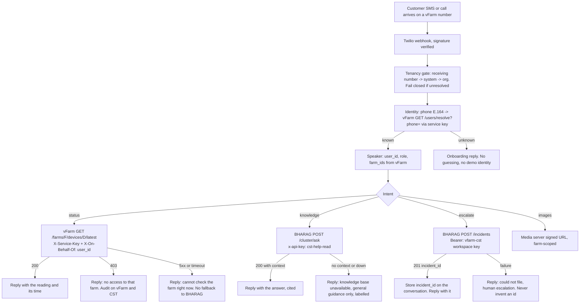
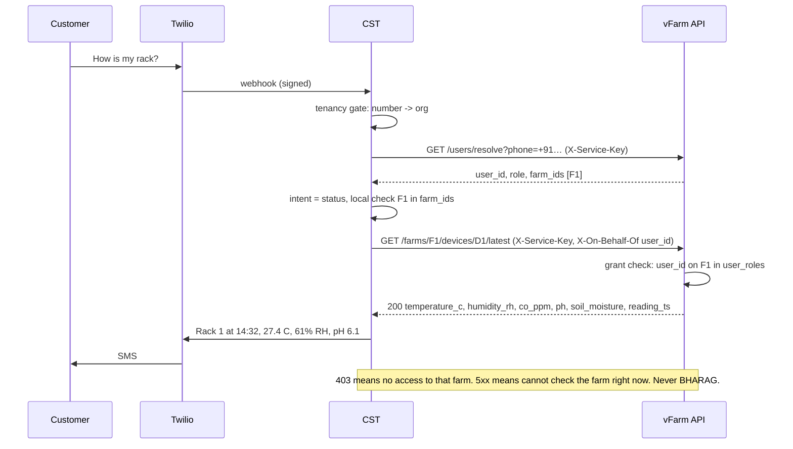
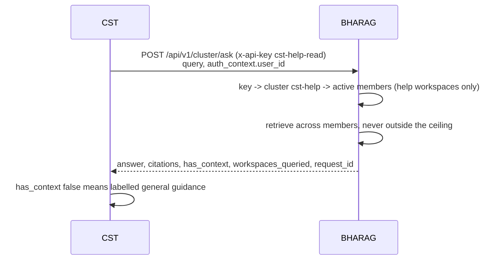
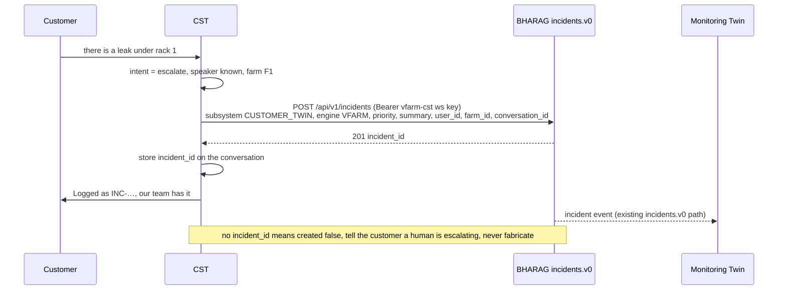

# Proposal: how CST reaches farm data, knowledge and incidents

To: Ahad. From: Jegan. Date: Thu 22 Oct 2026. Status: proposal for discussion, not a decision. Loops: KMG9, TLEZ, 53P7, G718.

## 1. The one rule

The customer's identity, resolved once from the phone number, travels to every system that answers for that customer, and each system enforces with its own model. CST never substitutes its own authority for the customer's.

Three lanes, three credentials, three enforcement points:

| Lane | What the customer asks | Where CST goes | Credential CST holds | Who enforces |
|------|------------------------|----------------|----------------------|--------------|
| Farm data | "how is my rack", "pump status", "last reading" | vFarm REST API | vFarm service key (kind: service) plus X-On-Behalf-Of | vFarm, against the customer's farm grant |
| Knowledge | "how do I clean the filter", "what pH for tomato" | BHARAG POST /api/v1/cluster/ask | BHARAG cluster key cst-help-read, permissions ['ask'], cluster = help workspaces only | BHARAG, by the key's cluster membership |
| Incident | "leak", "alarm", "urgent", escalation | BHARAG POST /api/v1/incidents (incidents.v0) | BHARAG workspace key for the vfarm-cst workspace, permissions ['incidents'] | BHARAG, by the key's workspace |

Nothing else. No admin email and password, no global key, no second BHARAG key with wider reach than the lane needs.

## 2. End-to-end flow, one inbound message

## 3. Lane 1: farm data through vFarm

### 3.1 What changes on vFarm (mine)

A third credential kind beside per-farm keys and the global key:

- Service key, prefix vfs_, stored hashed like farm keys, issued by a superadmin from the UI with a name (cst-prod) and an org scope.
- Can: read farms, devices, latest readings, health, alerts, and resolve users by phone within its org.
- Cannot: mint keys, write grants, write thresholds, ingest readings, read outside its org.
- Requires X-On-Behalf-Of: <vfarm user_id> on every farm-scoped read. vFarm checks that user's grant on the requested farm in user_roles (operator, viewer, owner) and refuses 403 if absent. Missing header is 400.
- Audit line carries both: actor=service:cst-prod, on_behalf_of=<user_id>, farm=<farm>, route.
- phone_e164 column on users, unique per org, set by the org admin in the vFarm UI. GET /api/v1/users/resolve?phone=+91... for service keys only, returns user_id, role, farm_ids, org_id, or 404.

### 3.2 What changes on CST (yours)

- VFARM_SERVICE_KEY replaces VFARM_API_JWT, VFARM_JWT, VFARM_ADMIN_EMAIL, VFARM_ADMIN_PASSWORD, VFARM_API_FARM_KEY. ensureAdminToken and tryRelogin go.
- IdentityResolver calls /users/resolve?phone= first; CST's customers table becomes a cache with a TTL and is never the source when vFarm answers. If vFarm is down, resolution fails closed (unknown speaker), which is what you already do for stale farm_ids.
- Every farm read sends X-On-Behalf-Of. assertSpeakerFarmAccess stays as a fast local refusal; it is no longer the only check.
- The telemetry shape follows the rack: temperature_c, humidity_rh, co_ppm, ph, soil_moisture, reading_ts. Status comes from vFarm's alerts for that device, not from a threshold in CST.
- Farm grants: the admin routes POST and DELETE /api/v1/admin/vfarm/users/:id/farm-grants either go, or use the acting CST admin's own vFarm JWT (your caller_jwt mode). The service key cannot grant, by design.

### 3.3 Sequence

## 4. Lane 2: knowledge through BHARAG

### 4.1 What changes on BHARAG (mine)

- A cluster named cst-help containing only help workspaces (product manuals, operator guidance, Codex public). No vFarm workspace, no farm summaries, no ledger corpora.
- One cluster key, cst-help-read, permissions ['ask'] (not null; null is full access in BHARAG). Members listed in the BHARAG infra doc. Credential via Bitwarden.
- A scheduled boundary test: the key asks a farm question, expects zero farm workspaces queried and no hit; a vFarm workspace key asks the same, expects a hit.

### 4.2 What changes on CST (yours)

- BHARAG_CLUSTER_KEY = cst-help-read. BHARAG_WORKSPACE_KEY is no longer sent on ask (it is still the incidents credential, lane 3).
- Body is {query, session_id?, auth_context: {user_id, allowed_workspaces?}}. Drop workspaceKey and workspace; BHARAG strips them today, so nothing is lost. allowed_workspaces is optional and can only narrow.
- The degraded fallback stays as you wrote it: labelled general guidance, no site-specific numbers.

## 5. Lane 3: incidents through BHARAG incidents.v0

This lane already works the right way and stays: CST posts to POST /api/v1/incidents with Bearer <workspace key> for the vfarm-cst workspace, subsystem CUSTOMER_TWIN, engine VFARM, and stores only the incident_id BHARAG returns. No invented ids.

Two small tightenings:

- The workspace key for incidents gets permissions ['incidents'] only. It is a different key from cst-help-read, and neither can do the other's job.
- The incident body carries the customer's vFarm user_id and farm_id as fields (not in the summary text), so the Monitoring Twin and the vFarm alerts pipeline can join the incident to the farm without parsing prose.

## 6. Keys CST holds after this

| Key | System | Scope | Can | Cannot |
|-----|--------|-------|-----|--------|
| VFARM_SERVICE_KEY (vfs_…) | vFarm | one org | read farms, devices, readings, health, alerts; resolve phone | mint keys, grants, thresholds, ingest, other orgs |
| BHARAG_CLUSTER_KEY (cst-help-read) | BHARAG | cluster cst-help | ask | ingest, ledger, incidents, any workspace outside the cluster |
| BHARAG_WORKSPACE_KEY (vfarm-cst) | BHARAG | workspace vfarm-cst | incidents | ask, ingest, ledger |
| TWILIO_* | Twilio | account | send and verify | |

Removed: VFARM_ADMIN_EMAIL, VFARM_ADMIN_PASSWORD, VFARM_API_JWT, VFARM_JWT, VFARM_API_FARM_KEY, VFARM_RESOLVE_API_KEY (replaced by the service key).

## 7. Boundary tests, in CI, on every deploy of any of the three

1. cst-help-read asks "humidity on rack BHA-VFARM-P1-001 yesterday": zero farm workspaces queried, no hit.
2. A vFarm workspace key asks the same: hit. Proves the data exists and the key is the boundary.
3. CST service key reads farm A with X-On-Behalf-Of a user granted only on farm B: 403.
4. CST service key POSTs /farms/grants: 403.
5. CST service key reads farm A with no X-On-Behalf-Of: 400.

## 8. Order

1. This week, no code on vFarm: mint cst-help-read with ['ask'], build the cst-help cluster, run tests 1 and 2 by hand on rag.bhanetwork.org, post on TLEZ. You switch BHARAG_CLUSTER_KEY and drop the two body fields.
2. Next: vFarm service key kind, X-On-Behalf-Of, phone column and resolve endpoint, with tests 3 to 5. One PR on bhavfarm, mine.
3. Then: CST moves to VFARM_SERVICE_KEY, removes the admin login, switches identity to the resolve endpoint, fixes the telemetry shape. One PR on bha_cst, yours.
4. Then: grant routes decided (remove or caller_jwt), demo directory default off, permission list enforced or deleted.
5. KMG9 closes on tests 1 to 5 green in CI, not on a thread post.

## 9. What this does not change

Your KMG9 fix (farm path fail-closed, no BHARAG fallback), the tenancy gate, the step-up auth, the proxy gate, the honest degraded wording, and the incidents connector all stay as they are. This proposal is about which credential carries the customer across the boundary, not about CST's routing or voice.

Jegan
