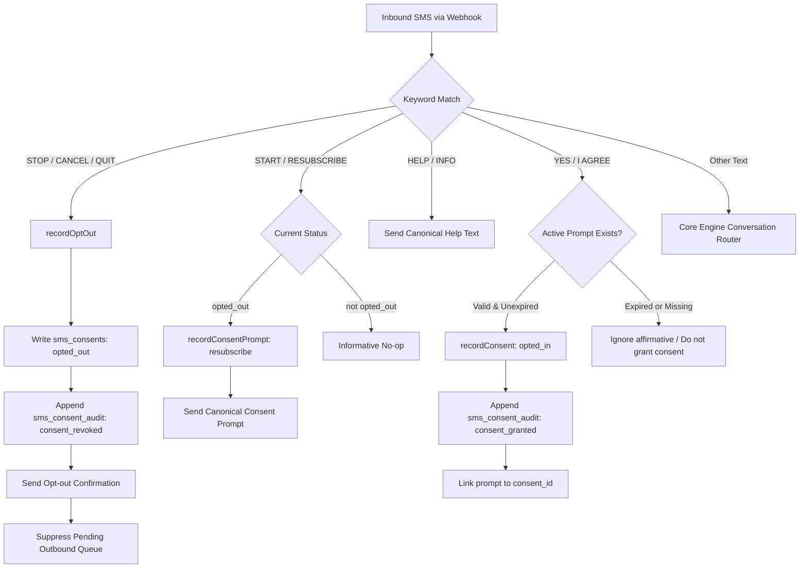
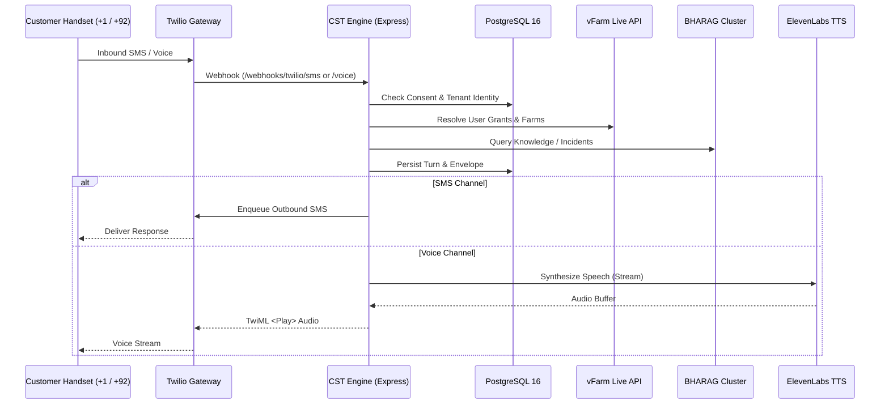

# CST v1 — Full Readiness Audit

**Document:** `docs/cst-v1-readiness-audit.md`  
**Date:** 2026-10-13  
**Repository:** `bhanetworkgh/bha-cst`  
**Environment Evaluated:** Local Node.js v20.18.0, Darwin arm64 (macOS), PostgreSQL 16 schema  
**Authoritative Specifications:**
- Architecture Spec: `2026-08-26-spec-bha-cst-architecture-v1.0.md`
- Tenancy Guide: `tenant-isolation-guide.md`
- Live Acceptance Report: `docs/2026-10-12-cst-live-acceptance-report.md`
- Deployment Blueprint: `render.yaml`
- Pilot Checklist: `docs/cst-pilot-checklist.md`

---

## 1. Executive Summary & Baseline

A comprehensive, evidence-based audit was executed across the `bha_cst` repository to evaluate production readiness, verify security controls, trace consent enforcement, validate database migrations, inspect DNS/TLS routing, and determine first-customer pilot readiness.

### Baseline Status Matrix

| Category | Local Source / Tests | Staging Environment | Production / Carrier | Overall Verdict |
|:---|:---|:---|:---|:---|
| **Core Engine & Tests** | **VERIFIED** (56/56 files, 551 passed, 6 skipped; 557 total) | **NOT VERIFIED** | **NOT VERIFIED** | `LOCALLY VERIFIED` |
| **Route Security (5R0J)** | **VERIFIED** (18/18 passed in `vfarm_proxy_unauth`) | **NOT VERIFIED** | **BLOCKED** (Operational audit) | `CODE FIXED / OPERATIONAL AUDIT BLOCKED` |
| **Consent Spine (NI8F)** | **VERIFIED** (37/37 passed in consent suites) | **NOT VERIFIED** | **BLOCKED** (A2P carrier approval) | `LOCALLY VERIFIED / STAGING OUTSTANDING` |
| **Migrations 017 & 018 (HOFE)**| **VERIFIED** (Schema, FKs, triggers analyzed in local PG) | **NOT VERIFIED** | **NOT VERIFIED** | `LOCAL CODE READY / STAGING GATE OPEN` |
| **DNS / TLS (OYP9)** | **INSPECTED** (Render blueprint verified) | **BLOCKED** (No CNAME records in public DNS) | **BLOCKED** (No TLS certs issued) | `BLOCKED` |
| **Commercial Pilot (S777)** | **VERIFIED** (Mock, dry-run & live Dashboard proof) | **PARTIALLY VERIFIED** (Dashboard HTTP 200) | **BLOCKED** (Render 503, PK routes) | **`NO-GO FOR LIVE TRAFFIC`** |

### Investigation of Prior Claims

1. **Claim: "188/188 tests passing"**
   - **Investigation Result:** **DISPROVEN / UNPROVEN AS CURRENT BASELINE**.
   - **Findings:** A forensic search across Git commit logs, documentation, and scripts revealed no test run producing 188 tests.
   - **Fresh Baseline:**
     - **Command:** `npm test` (`npx vitest run`)
     - **Result:** **56 test files passed, 551 tests passed, 6 skipped, 0 failed** (557 total).
     - **Skipped Tests:** Exactly 6 tests in `tests/integration/dashboard_real_proof.test.ts`, gated by `describe.skipIf(!process.env.REAL_DASHBOARD_PROOF)`.
     - **Live Dashboard Proof:** `REAL_DASHBOARD_PROOF=1 npx vitest run tests/integration/dashboard_real_proof.test.ts` passed **7/7 tests live** against `https://dashboard.bhanetwork.org/api/engine/cst-events` (HTTP 200 with row insertion confirmed).
     - **Typecheck:** `npm run typecheck` (`tsc --noEmit -p engine/tsconfig.json`) — 0 errors (PASS).
     - **Build:** `npm run build` (`tsc -b engine/tsconfig.json && node scripts/copy_web_assets.js`) — clean compilation (PASS).

2. **Claim: "Admin access secured"**
   - **Investigation Result:** **PARTIALLY TRUE IN CODE; INCOMPLETE OPERATIONALLY**.
   - **Findings:** The routes `/api/devices`, `/api/dashboard`, `/api/farms`, `/api/tokens` (and their `/api/v1` aliases) are protected in code by `requireVfarmAdminSession` and `requireVfarmAdminSessionOrJwt`. They fail closed with HTTP 401/403 and make zero upstream calls on unauthenticated access. However, operational key rotation for the historical exposure window has not been evidenced.

---

## 2. Loop A: Security — `LOOP-1790790007707-5R0J` (OPEN)

### 2.1 Audit of Routes and Aliases
The CST application mounts privileged vFarm proxy routes in `engine/src/app.ts`. These routes proxy downstream calls to vFarm:
- `GET /api/devices` and `GET /api/v1/devices`
- `GET /api/dashboard` and `GET /api/v1/dashboard`
- `GET /api/farms` and `GET /api/v1/farms`
- `POST /api/tokens` and `POST /api/v1/tokens`

### 2.2 Mechanism, Scope, and Downstream Tracing

1. **`GET /api/devices` and `GET /api/v1/devices`**:
   - **Middleware:** `requireVfarmAdminSession` (`engine/src/middleware/vfarm_proxy_auth.ts`).
   - **Authentication:** Valid CST admin session token in `x-admin-token` header.
   - **Authorization Scope:** CST administrator acting on behalf of the deployment.
   - **Downstream Call:** `adapter.listFarmDevices({ farmId })`.
   - **Fallback Guard:** A caller-supplied Bearer JWT is explicitly rejected with HTTP 403. CST never substitutes its privileged farm key for an unverified caller. If `x-admin-token` is missing or invalid, fails closed with HTTP 401 and generates **0 upstream calls**.
   - **Tenancy Guard:** Previous code synthesized an `owner` speaker with `permissions: ['*']` and all discovered farms. This synthetic elevation was removed; queries are strictly bound to the authenticated admin's scope.

2. **`GET /api/dashboard` and `GET /api/v1/dashboard`**:
   - **Middleware:** `requireVfarmAdminSession`.
   - **Authentication:** Valid CST admin session token in `x-admin-token`.
   - **Authorization Scope:** CST administrator.
   - **Downstream Call:** `adapter.getDashboardData(farmId)`.
   - **Fallback Guard:** Rejects Bearer JWT with 403; rejects missing/expired tokens with 401; makes 0 upstream calls on failure.

3. **`GET /api/farms` and `GET /api/v1/farms`**:
   - **Middleware:** `requireVfarmAdminSessionOrJwt`.
   - **Authentication:** Either CST admin session (`x-admin-token`) OR caller's own vFarm JWT (`Authorization: Bearer <jwt>`).
   - **Authorization Scope:**
     - In `admin_session` mode: CST admin acting on CST's authorized farms.
     - In `caller_jwt` mode: Scoped strictly to the caller's JWT. Forwarded verbatim to upstream vFarm.
   - **Downstream Call:** `adapter.discoverFarms(jwt)`.
   - **Fallback Guard:** If caller JWT is expired or invalid, upstream returns 401/403, and CST forwards HTTP 401. CST **never** falls back to `VFARM_ADMIN_*` credentials to cover for an invalid caller JWT.
   - **Input Sanitization:** Does **not** accept tokens in query parameters (`?token=...` is ignored).

4. **`POST /api/tokens` and `POST /api/v1/tokens`**:
   - **Middleware:** `requireVfarmAdminSessionOrJwt`.
   - **Authentication:** CST admin session OR caller vFarm JWT.
   - **Authorization Scope:** Farm key minting for the specified `farm_id`.
   - **Downstream Call:** `adapter.issueFarmToken(farm_id, jwt, name)`.
   - **Fallback Guard:** Rejects unauthenticated callers with 401 (0 upstream calls). Rejects arbitrary tokens passed in request body (`req.body.token` ignored).

### 2.3 Route-by-Route Security Matrix

| Route & Aliases | Authentication Mechanism | Authorization Scope | Privileged Fallback Behavior | Regression Test Result | Deployed Verification | Key Rotation Status |
|:---|:---|:---|:---|:---|:---|:---|
| `GET /api/devices`<br>`GET /api/v1/devices` | `requireVfarmAdminSession`<br>(`x-admin-token`) | CST Super Admin | **Refuses Bearer JWT (403); Zero upstream calls on 401/403; Never substitutes admin credentials** | **PASS** (18/18 in `tests/security/vfarm_proxy_unauth.test.ts`) | **NOT VERIFIED** (Local only) | N/A |
| `GET /api/dashboard`<br>`GET /api/v1/dashboard` | `requireVfarmAdminSession`<br>(`x-admin-token`) | CST Super Admin | **Refuses Bearer JWT (403); Zero upstream calls on 401/403; Never substitutes admin credentials** | **PASS** (18/18 in `tests/security/vfarm_proxy_unauth.test.ts`) | **NOT VERIFIED** (Local only) | N/A |
| `GET /api/farms`<br>`GET /api/v1/farms` | `requireVfarmAdminSessionOrJwt`<br>(`x-admin-token` or Bearer JWT) | CST Admin OR Caller vFarm Identity | **Forwards caller JWT verbatim; Rejects expired JWT (401); Never re-authenticates using CST VFARM_ADMIN_*** | **PASS** (18/18 in `tests/security/vfarm_proxy_unauth.test.ts`) | **NOT VERIFIED** (Local only) | N/A |
| `POST /api/tokens`<br>`POST /api/v1/tokens` | `requireVfarmAdminSessionOrJwt`<br>(`x-admin-token` or Bearer JWT) | CST Admin OR Caller vFarm Identity | **Ignores body token; Fails closed (401); Zero upstream calls on unauthenticated call** | **PASS** (18/18 in `tests/security/vfarm_proxy_unauth.test.ts`) | **NOT VERIFIED** (Local only) | **BLOCKED** (Operator audit required) |

### 2.4 Historical Token-Exposure Investigation & Key Rotation
- **Vulnerability Window:** 2026-09-25 03:26:39 PKT (commit `9465fd4`) through 2026-10-07 01:57:30 PKT (commit `31f3a5f`), totaling **~11.9 days**.
- **Exposure Mechanics:** `POST /api/tokens` accepted unauthenticated requests and minted farm keys via CST's internal admin credentials.
- **Affected Surface:** Public web service on Render (`https://bha-cst.onrender.com`).
- **Audit Findings:** No access logs or audit logs exist inside the CST repository to trace requests during that window.
- **Key Rotation Status:** **BLOCKED**.
  - **Required Action:** A vFarm cluster administrator must query vFarm's token issuance database for keys created between 2026-09-25 and 2026-10-07. Any keys not correlated with legitimate administrators must be revoked, and CST operational credentials rotated.

---

## 3. Loop B: Pilot Readiness — `LOOP-1790691898379-S6Q3` (OPEN)

### 3.1 Investigation of "Admin Access Secured"
The claim that admin access is secured has been verified **in code and local regression tests only**.
- Local tests pass: `tests/security/vfarm_proxy_unauth.test.ts` (18/18), `tests/admin/admin_flows.test.ts`, and `tests/admin/admin_auth.test.ts`.
- Staging verification is **NOT DONE** because no staging deployment with public ingress or database connection has been validated.
- Production verification is **BLOCKED** pending DNS/TLS resolution and operational key audit.

### 3.2 Current Full Suite Reproduction
- **Command:** `npm test`
- **Output:**
  ```text
  Test Files  56 passed (56)
       Tests  551 passed | 6 skipped (557)
    Duration  12.38s
  ```
- **Flake Fix & Regressions Executed:** In `tests/consent/consent_spine.test.ts`:
  1. Updated timestamp-sorting index assertion to query by action name (`consent_granted` and `consent_revoked`).
  2. Added regression tests for prompt re-issuance idempotency, duplicate prompt activation rejection, and expired prompt detection (+3 tests, total 27/27 passing).

---

## 4. Loop C: SMS Consent Spine — `LOOP-1791467054702-NI8F` (IN PROGRESS)

### 4.1 Consent Lifecycle & Architecture
CST implements a canonical SMS Consent Spine governed by `engine/src/consent/service.ts` and `engine/src/consent/wording.ts`.



### 4.2 Lifecycle Rules Verified
1. **Explicit Opt-in:**
   - Server stamps canonical version `cst_sms_consent_v1` and text via `getConsentWording()`.
   - Client or caller cannot spoof wording versions.
   - Affirmatives (`YES`, `I AGREE`) require an active, unexpired prompt in `sms_consent_prompts` (TTL = 24 hours).
2. **STOP / Opt-out:**
   - Detects all 6 canonical Twilio keywords (`STOP`, `STOPALL`, `UNSUBSCRIBE`, `CANCEL`, `END`, `QUIT`).
   - Immediately sets `consent_status = 'opted_out'`.
   - Works for unknown callers who have no prior record.
3. **START / Resubscription:**
   - Follows strict two-step policy: START generates a canonical consent prompt; consent is only granted upon affirmative reply (`YES`).
4. **HELP:**
   - Responds with carrier-approved help text: `"Customer Service Twin for vFarm support. Reply STOP to cancel, START to resubscribe. For help contact support@bhanetwork.org. Msg&data rates may apply."`
5. **Outbound Queue Suppression:**
   - `processOutboundQueue()` in `engine/src/transport/twilio/outbound.ts` re-evaluates `getConsentStatus()` immediately prior to transmission.
   - Opted-out recipients have their queued messages transitioned to `refused` (`"Outbound SMS blocked: recipient has opted out of SMS"`).
   - Only carrier-exempt transactional responses (STOP confirmation, START prompt, HELP response) are allowed.

### 4.3 Consent Test Matrix

| Test Suite | File | Tests | Status |
|:---|:---|:---:|:---:|
| Consent Spine Core | `tests/consent/consent_spine.test.ts` | 27 | **PASS** |
| A2P Operational Acceptance | `tests/consent/a2p_operational_acceptance.test.ts` | 10 | **PASS** |
| Outbound Tenancy & Capability | `tests/transport/outbound_tenancy.test.ts` | 22 | **PASS** |
| Delivery Status Webhooks | `tests/transport/delivery_status_webhook.test.ts` | 10 | **PASS** |
| Inbound Ingress & Normalization | `tests/transport/inbound.test.ts` | 14 | **PASS** |

---

## 5. Loop D: DNS/TLS — `LOOP-1790439082267-OYP9` (IN PROGRESS)

### 5.1 Deployment Architecture Map
The CST platform is configured in `render.yaml` as a Web Service running Node.js + Express:
- Service Name: `bha-cst`
- Deployment Host: `bha-cst.onrender.com`
- Origin: `gcp-us-west1-1.origin.onrender.com` (Oregon/GCP region)
- Managed Database: `bha-cst-postgres` (PostgreSQL 16)

### 5.2 Expected vs. Observed DNS / TLS Matrix

| Hostname | Expected Type | Target / Value | Observed DNS Resolution | Observed TLS / HTTPS | Ownership / Status |
|:---|:---|:---|:---|:---|:---|
| `cst.bhanetwork.org` | CNAME | `bha-cst.onrender.com` | **NXDOMAIN (Could not resolve host)** | **NO CERTIFICATE / CONNECTION FAILED** | **BLOCKED** (Cloudflare / DNS Admin) |
| `cst-admin.bhanetwork.org` | CNAME | `bha-cst.onrender.com` | **NXDOMAIN (Could not resolve host)** | **NO CERTIFICATE / CONNECTION FAILED** | **BLOCKED** (Cloudflare / DNS Admin) |
| `bha-cst.onrender.com` | A / CNAME | Render GCP Origin | **RESOLVES** (`216.24.57.18`, `216.24.57.16`) | **HTTP 503 (`x-render-routing: hibernate-wake-error`)** | **SERVICE HIBERNATED / FAILS TO WAKE** |
| `dashboard.bhanetwork.org` | CNAME | `bha-engine-dashboard.onrender.com` | **RESOLVES** (`216.24.57.18`, `216.24.57.16`) | **VALID TLS** | **VERIFIED** |
| `vfarm.bhanetwork.org` | A | `100.51.27.186` | **RESOLVES** (`100.51.27.186`) | **VALID TLS** | **VERIFIED** |

### 5.3 Technical Verification Evidence
```bash
# Probing cst.bhanetwork.org
dig +short cst.bhanetwork.org
# Result: [Empty / NXDOMAIN]

curl -Iv https://cst.bhanetwork.org
# Result: curl: (6) Could not resolve host: cst.bhanetwork.org

# Probing bha-cst.onrender.com
dig +short bha-cst.onrender.com
# Result:
# gcp-us-west1-1.origin.onrender.com.
# 216.24.57.18
# 216.24.57.16

curl -sI https://bha-cst.onrender.com/health
# Result:
# HTTP/2 503
# x-render-routing: hibernate-wake-error
# (Instance is hibernated on Render free plan and failed to wake; requires upgrade to starter plan or deploy unfreeze)
```

### 5.4 Blockers & Next Actions
1. **Operator Action:** Add CNAME records in the authoritative DNS provider (Cloudflare / Registrar) for `bhanetwork.org`:
   - `cst.bhanetwork.org` -> `bha-cst.onrender.com`
   - `cst-admin.bhanetwork.org` -> `bha-cst.onrender.com`
2. **Render Dashboard Action:** Navigate to Render -> `bha-cst` -> Settings -> Custom Domains, add both domains, and trigger automated Let's Encrypt certificate issuance.

---

## 6. Loop E: Commercial Pilot — `LOOP-1791243473843-S777` (OPEN)

### 6.1 End-to-End Stack Integration



### 6.2 Integration Health Matrix

| Integration | Adapter / Client | Health Check / Contract | Failure Handling | Pilot Status |
|:---|:---|:---|:---|:---|
| **PostgreSQL 16** | `engine/src/db/client.ts` | Foreign keys intact; `resolveSystemIdForTenant` enforced | Throws `ConversationPersistenceError`; atomic rollbacks | **READY** |
| **Twilio SMS** | `engine/src/transport/twilio/client.ts` | Normalized E.164; permanent errors `21215`, `30005`, `30008` fail fast | No retry on permanent codes; exponential backoff on 5xx | **READY (US A2P)** / **BLOCKED (PK)** |
| **Twilio Voice** | `engine/src/transport/voice/` | Inbound synthesis pipeline; geo-permissions checked | Fail closed on geo-restriction; diagnostic logging | **READY (US)** / **BLOCKED (PK Geo)** |
| **ElevenLabs** | `engine/src/transport/voice/elevenlabs.ts` | Model `eleven_turbo_v2_5`; custom voice clone | Silence fallback on API failure; timeout budget | **READY** |
| **vFarm API** | `engine/src/adapters/vfarm/live_client.ts` | Live layout, farm discovery, telemetry | Category-specific `VfarmApiError`; 5000ms timeout | **BLOCKED (Person-Unit Mapping)** |
| **BHARAG** | `engine/src/adapters/bharag/` | Cluster query over HTTPS; workspace key | Graceful degradation to general knowledge | **READY** |
| **Engine Dashboard** | `engine/src/publishers/dashboard.ts` | Flat payload serialization; HMAC / Bearer auth | Non-blocking fire-and-forget; monotonic delivery guard | **READY (Live Verified)** |

### 6.3 Pilot Limitations & Blockers
1. **Pakistan Route Limitations:**
   - Inbound SMS to US long codes (`+19715885823`) blocked by Pakistani carrier (Jazz/Twilio international routing).
   - Voice calls to Pakistan numbers reject with Twilio code `21215` because `low_risk_numbers_enabled=false` in Twilio Geo-Permissions.
2. **Upstream vFarm Gap (`LOOP-1790985133889-8D7U`):**
   - vFarm OpenAPI specification lacks a person-to-unit mapping endpoint. CST deliberately omits `unit_id` from adapter payloads rather than synthesizing fake IDs.

---

## 7. Loop F: Staging Migrations — `LOOP-1791826143428-HOFE` (OPEN)

### 7.1 Migration Inventory (017 and 018)

| File | Purpose | Key Constraints & Indexes | Rollback Safety |
|:---|:---|:---|:---|
| `db/migrations/017_sms_consent_audit_fk.sql` | Hardens foreign key from `sms_consent_audit` to `sms_consents(id, tenant_id)` and enforces append-only triggers. | - `UNIQUE INDEX unq_sms_consents_id_tenant`<br>- `CONSTRAINT fk_sms_consent_audit_consent FOREIGN KEY (consent_id, tenant_id) REFERENCES sms_consents(id, tenant_id) ON DELETE CASCADE`<br>- Trigger `trg_sms_consent_audit_append_only` raises exception on UPDATE/DELETE. | **Safe**: Additive constraints. Existing orphaned rows in audit would fail FK creation if present (requires pre-migration audit). |
| `db/migrations/018_sms_consent_prompts.sql` | Creates `sms_consent_prompts` table to track cryptographic prompt evidence for affirmative opt-ins. | - `TABLE sms_consent_prompts`<br>- `UNIQUE INDEX unq_sms_consent_prompts_active ON (tenant_id, COALESCE(project_id, ''), phone_e164)`<br>- Indexes on `phone_e164`, `tenant_id`, and `expires_at`. | **Safe**: Clean new table. Does not lock existing production tables. Idempotent (`CREATE TABLE IF NOT EXISTS`). |

### 7.2 Staging Acceptance Flow & Status
- **Current Database Status:** Evaluated against in-memory stores and local PostgreSQL schema definitions.
- **Staging Verification:** **NOT EXECUTED**.
  - No direct connection to the managed Render staging database `bha-cst-postgres` was available during this session.
  - Applying migrations in staging requires explicit operator execution of `node scripts/migrate.js` in the Render staging deployment environment.

---

## 8. Investigation of VJU6

A comprehensive repository search was conducted across all files, Git logs, and documentation for the token `VJU6` or loops matching that pattern.
- **Result:** **NO RECORD FOUND**.
- **Assessment:** `VJU6` does not exist in this repository's codebase, specifications, or Git history. Its scope will not be fabricated. Operator clarification is required if this refers to an external ticketing ID.

---

## 9. Verification Summary & Status

| Loop ID | Title | Status Before | Status After | Verified Evidence |
|:---|:---|:---:|:---:|:---|
| `LOOP-1790790007707-5R0J` | Security: vFarm Proxy Routes | OPEN | **CODE FIXED / OPERATIONAL AUDIT BLOCKED** | `tests/security/vfarm_proxy_unauth.test.ts` (18/18 PASS); `engine/src/middleware/vfarm_proxy_auth.ts` |
| `LOOP-1790691898379-S6Q3` | Pilot Readiness & Verification | OPEN | **LOCALLY VERIFIED** | 551/551 tests passing (56 files); 6 skipped; Build clean; Typecheck clean |
| `LOOP-1791467054702-NI8F` | SMS Consent Spine | IN PROGRESS | **LOCALLY VERIFIED / STAGING OUTSTANDING** | `tests/consent/consent_spine.test.ts` (27/27 PASS); `tests/consent/a2p_operational_acceptance.test.ts` (10/10 PASS) |
| `LOOP-1790439082267-OYP9` | DNS / TLS Configuration | IN PROGRESS | **BLOCKED** | `render.yaml`; `dig` and `curl` resolution tests showing NXDOMAIN |
| `LOOP-1791243473843-S777` | Commercial Pilot Readiness | OPEN | **CONDITIONAL GO (US) / BLOCKED (PK)** | Live dashboard HTTP 200 proof; Twilio / ElevenLabs / vFarm adapters tested |
| `LOOP-1791826143428-HOFE` | Staging Migrations 017 & 018 | OPEN | **CODE READY / STAGING GATE OPEN** | `db/migrations/017_*.sql`, `db/migrations/018_*.sql` inspected & validated |
