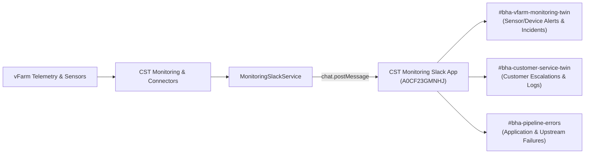

# CST Monitoring Slack Integration Guide

## 1. Overview & Architecture

This document specifies the integration of the pre-existing **CST Monitoring Slack App** (App ID: `A0CF23GMNHJ`, Bot User ID: `U0CF23JSUG4`) into the Customer Service Twin (CST) engine to provide operational alerting, incident tracking, customer escalations, and incident recovery notifications.

### 1.1 Architecture & Event Flow



### 1.2 Key Design Principles
1. **Direct Slack Web API Delivery:** Uses Slack Web API `https://slack.com/api/chat.postMessage` authenticated via `Bearer ${SLACK_BOT_TOKEN}`. No intermediate n8n webhook or proxy layer is required solely for message delivery.
2. **Reuses Existing Installed Slack App:** Employs the existing CST Monitoring app created and installed in the Bays Horizon Network Slack workspace.
3. **Fail-Safe Operational Side-Effect:** Outbound Slack notifications are non-blocking side-effects. Network failures, rate-limiting, or missing credentials in Slack never abort or delay customer voice turns, SMS deliveries, or database transactions.
4. **Authoritative State Preservation:** Slack notifications reflect authoritative calculations from vFarm telemetry and CST core connectors. No synthetic topology or fabricated readings are introduced.
5. **Privacy & Tenancy Boundaries:** Customer telephone numbers are automatically masked (`+1971***5823`), mrkdwn injection characters (`<`, `>`, `&`) are sanitized, credentials and tokens are redacted from metadata, and tenant boundaries are strictly preserved.

---

## 2. Existing Slack App Details

| Property | Value | Notes |
|---|---|---|
| **App Name** | CST Monitoring / `cst_twin` | Installed in Bays Horizon Network workspace |
| **App ID** | `A0CF23GMNHJ` | Configured in workspace settings |
| **Bot User ID** | `U0CF23JSUG4` | The bot identity posting to channels |
| **Bot ID** | `B0CES5KRVV1` | Underlying bot instance identifier |
| **Minimum Required Bot Scope** | `chat:write` | Required for outbound `chat.postMessage` |
| **Optional Verification Scope** | `channels:history`, `groups:history` | For automated receipt verification if needed |

---

## 3. Environment Variables & Render Configuration

The service checks the following environment variables (sourced from Render Dashboard or local `.env`):

| Variable | Required | Description | Example |
|---|---|---|---|
| `SLACK_BOT_TOKEN` | Yes | Bot User OAuth Token for App `A0CF23GMNHJ` | `xoxb-***` |
| `SLACK_MONITORING_CHANNEL_ID` | Optional | Target channel ID for monitoring alerts, sensor stale/offline, device degraded, incidents (default: `C0B8JTE51PG`) | `C0B8JTE51PG` |
| `SLACK_VFARM_MONITORING_CHANNEL_ID` | Optional | Fallback alias for `SLACK_MONITORING_CHANNEL_ID` | `C0B8JTE51PG` |
| `SLACK_CS_CHANNEL_ID` | Optional | Channel ID for customer escalations (default: `C0BD6D53HAM`) | `C0BD6D53HAM` |
| `SLACK_PIPELINE_ERRORS_CHANNEL_ID` | Optional | Channel ID for pipeline/transport errors (default: `C0ATC4CA3G9`) | `C0ATC4CA3G9` |
| `SLACK_ALERTS_ENABLED` | Optional | Master kill-switch for Slack alerts (`true` by default) | `true` |

---

## 4. Channel Topology & Routing Matrix

| Event Class | Scenario | Destination Channel | Channel ID Resolution Order |
|---|---|---|---|
| **Sensor Offline** | Sensor stopped reporting or in `fault`/`offline` status | `#bha-vfarm-monitoring-twin` | `SLACK_MONITORING_CHANNEL_ID` → `SLACK_VFARM_MONITORING_CHANNEL_ID` → `C0B8JTE51PG` |
| **Sensor Stale** | Sensor reading timestamp > 24 hours old | `#bha-vfarm-monitoring-twin` | `SLACK_MONITORING_CHANNEL_ID` → `SLACK_VFARM_MONITORING_CHANNEL_ID` → `C0B8JTE51PG` |
| **Device Degraded** | Dependent device status computed as `DEGRADED` from upstream sensors | `#bha-vfarm-monitoring-twin` | `SLACK_MONITORING_CHANNEL_ID` → `SLACK_VFARM_MONITORING_CHANNEL_ID` → `C0B8JTE51PG` |
| **Farm Incident** | Critical farm-wide incident or repeat failure threshold crossed | `#bha-vfarm-monitoring-twin` | `SLACK_MONITORING_CHANNEL_ID` → `SLACK_VFARM_MONITORING_CHANNEL_ID` → `C0B8JTE51PG` |
| **Customer Escalation** | Caller/texter requested human assistance | `#bha-customer-service-twin` | `SLACK_CS_CHANNEL_ID` → `CST_HANDOFF_CHANNEL_ID` → `C0BD6D53HAM` |
| **Upstream API Failure** | Repeated vFarm API 5xx/422 or connection drops | `#bha-pipeline-errors` or Monitoring | `SLACK_PIPELINE_ERRORS_CHANNEL_ID` → `C0ATC4CA3G9` |
| **Incident Recovery** | Degraded/offline incident restored to healthy/normal | Original Incident Channel | Uses channel recorded during original incident |

---

## 5. Event Payload Schemas & Service API

The service is exposed via `engine/src/notifications/monitoring_slack_service.ts`:

### 5.1 `sendMonitoringAlert(event: MonitoringAlertEvent)`
```typescript
interface MonitoringAlertEvent {
  type: 'sensor_offline' | 'sensor_stale' | 'device_degraded' | 'vfarm_api_failure';
  severity: 'CRITICAL' | 'HIGH' | 'WARN' | 'INFO';
  system: string;
  farm_id?: string;
  device_id?: string;
  sensor_id?: string;
  reason: string;
  last_reading_at?: string | null;
  correlation_id?: string;
  tenant_id?: string | null;
  project_id?: string | null;
  meta?: Record<string, unknown>;
  timestamp?: string;
  channel_id?: string;
}
```

### 5.2 `sendIncidentNotification(event: IncidentNotificationEvent)`
```typescript
interface IncidentNotificationEvent {
  incident_id?: string;
  title: string;
  severity: 'CRITICAL' | 'HIGH' | 'WARN';
  system: string;
  farm_id?: string;
  device_id?: string;
  reason: string;
  diagnostic_info?: string | Record<string, unknown>;
  correlation_id?: string;
  tenant_id?: string | null;
  project_id?: string | null;
  dashboard_url?: string;
  timestamp?: string;
  channel_id?: string;
}
```

### 5.3 `sendEscalationNotification(event: EscalationNotificationEvent)`
```typescript
interface EscalationNotificationEvent {
  escalation_id?: string;
  caller_phone: string;
  reason: string;
  severity?: 'WARN' | 'INFO';
  conversation_id?: string;
  correlation_id?: string;
  caller_email?: string;
  tenant_id?: string | null;
  project_id?: string | null;
  timestamp?: string;
  channel_id?: string;
}
```

### 5.4 `sendRecoveryNotification(event: RecoveryNotificationEvent)`
```typescript
interface RecoveryNotificationEvent {
  original_incident_id?: string;
  system: string;
  farm_id?: string;
  device_id?: string;
  previous_state: string;
  current_state: string;
  recovery_reason: string;
  duration_ms?: number;
  correlation_id?: string;
  tenant_id?: string | null;
  project_id?: string | null;
  timestamp?: string;
  channel_id?: string;
}
```

---

## 6. Reliability & Delivery Mechanics

1. **Deduplication:** A sliding window of 60,000ms prevents flooding channels during repeated checks or burst failures.
2. **Rate-Limiting (HTTP 429):** Reads Slack's `Retry-After` header and performs bounded exponential backoff up to 2 retries (3 attempts total).
3. **Transient Server Errors (HTTP 5xx / Network Abort):** Retried automatically with exponential backoff.
4. **Permanent Failure Handling:** Errors such as `invalid_auth`, `channel_not_found`, `not_in_channel` fail immediately without wasteful retries.
5. **Failed Deliveries Queue:** All failed deliveries are captured in memory (`getFailedDeliveries()`) and can be retried via `retryFailedDeliveries()`.
6. **Graceful Deferral:** If `SLACK_BOT_TOKEN` or channel configuration is unset, notifications return `status: 'deferred'` with a structured warning log without crashing.

---

## 7. Relationship with Loop 80HM

1. **Operational Notification Mechanism:** The direct CST-to-Slack integration provides the operational alerting mechanism for Monitoring Twin.
2. **Independent from Upstream Topology:** Sending Slack alerts does not replace the missing vFarm topology contract, nor does it fake sensor-to-device relationships.
3. **No n8n Dependency:** Direct Slack integration via the existing bot eliminates the need to route notifications through an external n8n workflow.
4. **Acceptance Status:** Loop 80HM remains pending authoritative vFarm upstream device topology and production deployment verification.

---

## 8. Setup & Action Items for Operations

1. **Confirm / Designate Channel ID for `#bha-vfarm-monitoring-twin`:**
   Obtain the channel ID (e.g. `C0...`) for `#bha-vfarm-monitoring-twin` from the Slack workspace.
2. **Invite the CST Monitoring Bot:**
   In Slack, run `/invite @cst_twin` (Bot User ID `U0CF23JSUG4`) into `#bha-vfarm-monitoring-twin`.
3. **Configure Render Environment Variables:**
   Add `SLACK_MONITORING_CHANNEL_ID=<channel_id>` in the Render Dashboard under `bha-cst` service environment settings.
4. **Verify Live Delivery:**
   After configuration, trigger a test notification with explicit operator approval.
