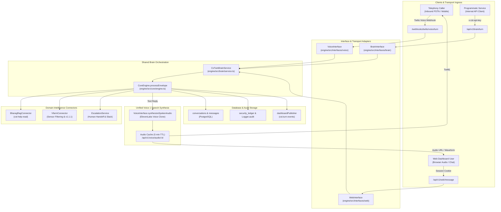

# CS Twin v1 — Implementation & Rollout Plan

**Document Version:** 1.0.0  
**Date:** 2026-11-03  
**Status:** ACTIVE_IMPLEMENTATION  
**Lead Engineer:** Senior CST Acceptance & Systems Architecture Engineer (Ahad)  
**Trackers:**
- Architecture Loop: [`LOOP-1789824812431-IWKX`](https://dashboard.bhanetwork.org/open-loops/LOOP-1789824812431-IWKX)
- Decision Watch: `DW-1793621652529-3PQN`
- Master Pay-Gate: `DW-1793626498819-PDQ2`
- Specification Reference: [`docs/specs/CS_TWIN_V1_LOCKED_SPEC.md`](../specs/CS_TWIN_V1_LOCKED_SPEC.md)

---

## 1. System Architecture & Component Diagram

---

## 2. Component Inventory

### 2.1 Existing Modules Reused (Zero Duplication)
1. `engine/src/core/engine.ts` (`CoreEngine.processEnvelope`): The canonical multi-tenant conversation engine, transcript writer, and audit emitter.
2. `engine/src/core/registry.ts` (`CoreRegistry`): Authoritative in-memory registry of tenants, projects, service numbers, and adapters.
3. `engine/src/router/index.ts` (`IntentRouter`): Intent classification pipeline.
4. `engine/src/connectors/bharag_rag.ts` (`BharagRagConnector`): Strict RAG connector using key `cst-help-read`.
5. `engine/src/adapters/vfarm/index.ts` (`VfarmTenantAdapter`): Identity resolution, permission verification, and sensor-filtered device queries.
6. `engine/src/audio/synthesis.ts` (`AudioSynthesizer`): ElevenLabs voice synthesis connector.
7. `engine/src/escalation/service.ts` (`EscalationService`): Durable escalation ledger and Slack notifier.
8. `engine/src/db/client.ts` (`DbClient`): PostgreSQL connection pool, schema migrations, and transcript store.

### 2.2 New Modules Introduced
1. `engine/src/brain/schemas.ts`: Zod 4 wire validation schemas for `BrainTurnRequest` and `BrainTurnResponse`.
2. `engine/src/brain/service.ts`: `CsTwinBrainService` providing the unified, tenancy-scoped brain orchestration facade used by web, voice, and programmatic callers.
3. `engine/src/interfaces/brain/index.ts`: HTTP router exposing `POST /api/v1/brain/turn` and `POST /api/v1/brain/chat`.
4. `tests/brain/brain_turn.test.ts`: Dedicated suite verifying request validation, tenant isolation, conversation persistence, audit logging, and deadline timeouts.

---

## 3. Detailed Phase Breakdown

### Phase 1: Brain Service & Schema Implementation
- **Objective:** Establish the typed Zod schemas and service facade `CsTwinBrainService` that unifies conversation execution while strictly resolving tenancy server-side.
- **Files Modified / Created:**
  - `engine/src/brain/schemas.ts`
  - `engine/src/brain/service.ts`
- **Implementation Action:** Implement `BrainTurnRequestSchema`, `BrainTurnResponseSchema`, and `CsTwinBrainService.processTurn`. The service validates input, enforces server-side tenancy, constructs `MessageEnvelope`, executes `CoreEngine.processEnvelope`, and returns structured responses.
- **Dependencies:** `CoreEngine`, `CoreRegistry`, `DbClient`.
- **Acceptance Criteria:** Zod schemas reject invalid inputs; server-resolved tenancy rejects caller overrides; conversations are persisted to PostgreSQL.
- **Evidence Required:** Unit test suite passing with 100% assertions.
- **Owner:** Ahad.

### Phase 2: Brain REST API Route & Express Integration
- **Objective:** Mount `POST /api/v1/brain/turn` and `POST /api/v1/brain/chat` with constant-time API key and session authentication.
- **Files Modified / Created:**
  - `engine/src/interfaces/brain/index.ts`
  - `engine/src/app.ts`
- **Implementation Action:** Add `brainInterfaceRouter` to `createApp()` with `enforceTenancyGate` and API key verification (`CST_API_KEY`).
- **Dependencies:** `express`, `engine/src/middleware/programmatic_api_key.ts`.
- **Acceptance Criteria:** Unauthenticated calls return 401; mismatched tenant bodies return 403; valid calls return 200 OK with `turn_id` and correlated transcript.
- **Evidence Required:** Integration tests using `supertest`.
- **Owner:** Ahad.

### Phase 3: Unification of Web & Voice Transports
- **Objective:** Align `WebInterface` and `VoiceInterface` with `CsTwinBrainService` so that all three entry points utilize identical conversation processing, timeout guards, and audio synthesis pipelines.
- **Files Modified:**
  - `engine/src/interfaces/web/index.ts`
  - `engine/src/interfaces/voice/index.ts`
- **Implementation Action:** Refactor web and voice ingress handlers to delegate turn orchestration to the unified pipeline.
- **Dependencies:** Phase 1 & Phase 2.
- **Acceptance Criteria:** Web chat messages and voice turns produce identical audit footprints and transcript rows.
- **Evidence Required:** Playwright browser tests and voice lifecycle tests passing.
- **Owner:** Ahad.

### Phase 4: Alert Events & Escalation Contract ADR
- **Objective:** Record architectural decision on alert events, audit immutability, rendered body storage, and Kavin decision points.
- **Files Created:**
  - `docs/adr/ADR-0002-alert-events-audit-contract.md`
- **Implementation Action:** Draft comprehensive ADR with all 13 required decision criteria and explicit pending status awaiting Kavin's confirmation.
- **Dependencies:** Migration 008 (`alert_audit_log`), Migration 022 (`escalations`).
- **Acceptance Criteria:** ADR cleanly recorded in `docs/adr/` with zero conflicting decisions.
- **Evidence Required:** ADR markdown file.
- **Owner:** Ahad / Kavin.

### Phase 5: Verification & Acceptance Sign-Off
- **Objective:** Execute full automated test run (typecheck, vitest, playwright browser suite) and produce evidence package.
- **Files Created:**
  - `docs/reports/CS_TWIN_V1_FIRST_SLICE_EVIDENCE.md`
  - `docs/reports/CS_TWIN_V1_LOOP_UPDATE_DRAFTS.md`
- **Implementation Action:** Run all suites, capture exact terminal outputs, verify SHA, document loop tracker updates.
- **Dependencies:** All prior phases.
- **Acceptance Criteria:** 0 TS errors, 100% vitest pass, 28 browser tests pass.
- **Evidence Required:** Timestamped logs and evidence reports.
- **Owner:** Ahad / Jason.

---

## 4. Operational Boundaries & Rollback Strategy

1. **Database Schema:** No database migrations are required for the first slice. Existing tables (`conversations`, `messages_in`, `messages_out`, `voice_deliveries`, `security_ledger`, `alert_audit_log`) completely satisfy the schema requirements.
2. **Telephony Safety:** Inbound voice turns and outbound calls remain locked behind `--confirm-live-call` flags and require explicit Jason approval.
3. **Rollback Strategy:** If any regression is observed on the Brain API, the router is cleanly unmounted in `app.ts` without affecting existing SMS or web session endpoints.

