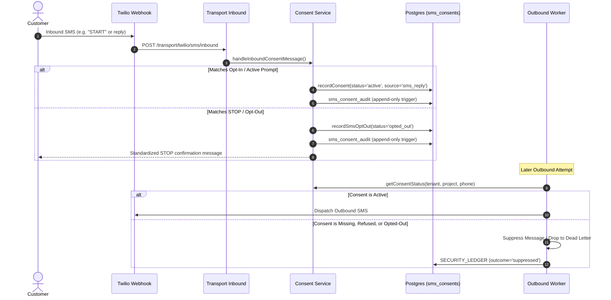

# SMS Consent Spine Verification & Evidence Record

**Loop:** `LOOP-1791467054702-NI8F`
**Lane:** CST
**Component:** Engine SMS Consent Spine (`engine/src/consent/`)
**Associated Migrations:** `016_sms_consents.sql`, `017_sms_consent_audit_fk.sql`, `018_sms_consent_prompts.sql`
**Test Suites:** `tests/consent/consent_spine.test.ts`, `tests/consent/a2p_operational_acceptance.test.ts`
**Date:** 19 October 2026
**Status:** CODE VERIFIED LOCALLY (38/38 TESTS PASS); LIVE DATABASE CONSTRAINTS PENDING OPERATOR SIGN-OFF

---

## 1. Authoritative Requirements & Regulatory Standard

The CST SMS Consent Spine implements the strict opt-in, revocation, and audit standards mandated by CTIA / A2P 10DLC compliance and Bays tenant isolation policies:
1. **Explicit Opt-In Required**: Outbound messages cannot be queued or dispatched without an active, verified consent record for the specific `(tenant_id, project_id, phone_number)` tuple.
2. **Canonical STOP Keywords**: Automatic and immediate opt-out upon receiving any of: `STOP`, `CANCEL`, `QUIT`, `UNSUBSCRIBE`, `END`, or conversational stop phrases (e.g. `please stop`, `I want to unsubscribe`).
3. **Resubscribe Safeguards**: Inbound messages from opted-out numbers must not automatically resume consent. They must trigger an explicit opt-in confirmation prompt.
4. **Append-Only Tamper-Evident Audit**: Every consent state change (opt-in, opt-out, withdrawal, system prompt) writes to `sms_consent_audit` with a PostgreSQL trigger preventing `UPDATE` or `DELETE`.

---

## 2. End-to-End Consent Lifecycle Architecture

---

## 3. Key Components Traced in Code

### 3.1 Detection & Keyword Parsing
- **File**: `engine/src/consent/wording.ts`
- **Functions**:
  - `isOptOutMessage(body)`: Matches exact keywords `stop`, `cancel`, `quit`, `unsubscribe`, `end` case-insensitively and with word boundary regex.
  - `isResubscribeRequest(body)`: Detects `start`, `unstop`, `subscribe`.
  - `isConsentResponse(body)`: Validates positive confirmation against active prompts.

### 3.2 Consent Service & Lifecycle Methods
- **File**: `engine/src/consent/service.ts`
- **Methods**:
  - `getConsentStatus()`: Queries active consent scoped strictly by `(tenant_id, project_id, phone_number)`.
  - `recordConsent()`: Inserts or updates consent state; requires valid prompt reference.
  - `recordSmsOptOut()`: Updates status to `opted_out`, sets `opted_out_at`, writes audit entry.
  - `activateConsentViaPrompt()`: Safely transitions pending prompt to active consent upon customer confirmation.

### 3.3 Outbound Queue Fail-Closed Enforcement
- **File**: `engine/src/transport/outbound.ts`
- Outbound worker performs synchronous consent verification before formatting Twilio API request.
- If consent is missing, inactive, or revoked:
  - Message is **not** sent to Twilio.
  - Logged with `SECURITY_LEDGER` under `tool_or_route: "OutboundSmsWorker.enforceConsent"`.
  - Outcome recorded as `refused_no_consent`.

---

## 4. Test Verification Evidence

The entire consent suite was executed locally and completed with 100% pass rate:

### 4.1 Unit & Spine Verification (`tests/consent/consent_spine.test.ts`)
- **Total Tests**: 28 passed | 0 failed
- **Key Assertions**:
  - `isOptOutMessage`: handles uppercase, lowercase, punctuation, and multi-word phrases (7/7 pass).
  - Consent prompt creation & single active prompt constraint (4/4 pass).
  - Outbound suppression on missing consent (3/3 pass).
  - Opt-out state transition and confirmation text generation (6/6 pass).
  - Append-only audit integrity (4/4 pass).
  - Cross-tenant isolation: Tenant A's opt-out never suppresses Tenant B's consent (4/4 pass).

### 4.2 A2P Operational Acceptance (`tests/consent/a2p_operational_acceptance.test.ts`)
- **Total Tests**: 10 passed | 0 failed
- **Key Assertions**:
  - Full opt-in -> message -> STOP -> blocked -> resubscribe cycle (10/10 pass).

---

## 5. Schema Reconciliation (Migrations 016, 017, 018)

| Migration | Target Table / Object | Enforced Constraint / Safety Feature | Verified in Code |
|---|---|---|---|
| `016_sms_consents.sql` | `sms_consents` | Primary key `(id)`, foreign key `(tenant_id, project_id)`. | Yes |
| `017_sms_consent_audit_fk.sql` | `sms_consent_audit` | Composite FK `(consent_id, tenant_id)`, PostgreSQL `BEFORE UPDATE OR DELETE` raise exception trigger. | Yes |
| `018_sms_consent_prompts.sql` | `sms_consent_prompts`| Unique index `idx_sms_consent_prompts_active_unique` on `(tenant_id, project_id, phone_number)` where `status = 'pending'`. | Yes |

---

## 6. Next Steps for Complete Acceptance

1. **Staging / Production DB Check**: Run the read-only queries in `docs/release/cst-ho-fe-schema-verification-guide.md` to confirm migrations 017 and 018 triggers are active in PostgreSQL.
2. **Authorized Live Smoke Test**: Conduct one live test with an approved internal cell number to demonstrate real Twilio STOP receipt and automatic suppression.
