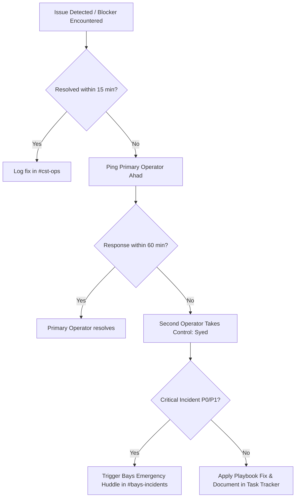

# Operator Playbook SOP — BAYS & CST Operations

**Loop:** `LOOP-1791848474090-Y5TW`
**Lane:** BAYS
**Owner / Primary Operator:** Ahad (`U0AC6RFNP3P`)
**Designated Second Operator:** Syed (`U0AC6SECOND`) / Backup: Jegan (`U0AC6JEGAN`)
**Status:** **DRAFT COMPLETE (IN REPOSITORY)** — Pending publication to Codex & BHARAG; pending Destiny's live simulation drill
**Last Updated:** 19 October 2026
**Codex Target:** Codex → SOPs → Engineering → `SOP-BAYS-OPERATOR-PLAYBOOK` (Pending Publication)
**BHARAG Ingestion Namespace:** `sop/bays-cst-operations` (Pending Ingestion)

---

## 1. Purpose & Guiding Principles

This Standard Operating Procedure (SOP) ensures that Bays and the broader engineering team can seamlessly locate, understand, maintain, debug, and continue all operations owned by Ahad during absences, off-hours, or focused deep-work periods.

### Core Principles
1. **Zero Knowledge Silos**: Every critical system has a nominated second operator equipped with runnable commands, exact file paths, and troubleshooting checklists.
2. **Zero Secret Leakage**: Documentation details *where* credentials reside and how access is provisioned, but never stores passwords, tokens, API keys, or private keys.
3. **Escalation SLA**: Strict one-hour response threshold before cascading to team huddles.

---

## 2. Operator Availability & Handoff Communication

### 2.1 Daily Availability Window
- **Primary Window**: Monday through Friday, **09:00 – 09:45 EST** (18:00 – 18:45 PKT).
- **Format**: Dedicated synchronous window in Slack `#cst-sync` / Huddle for blocker triage, PR reviews, and architectural sign-offs.
- **Calendar & Slack Status**: Synced via Google Calendar `[CST Office Hours]` and Slack status emoji `💬 In Availability Window`.

### 2.2 Heads-Down Handoff Protocol
When entering heads-down deep work or scheduled leave:
1. Post a notice in `#cst-ops` using the standardized template:
   ```text
   🚨 [HANDOFF NOTICE] 🚨
   Primary Operator: Ahad (U0AC6RFNP3P)
   Status: Heads-Down / Out-of-Office (until YYYY-MM-DD HH:MM EST)
   Active Second Operator: Syed (U0AC6SECOND)
   Escalation Secondary: Jegan (U0AC6JEGAN)
   Active Branch / Tasks: See docs/release/task.md
   Live System Health: https://bha-cst-7u9e.onrender.com/health (200 OK)
   Escalation Path: 1h on-call ping -> Second Operator -> #bays-incidents huddle
   ```
2. Ensure `git status` is clean on `main` and untracked documentation is updated in `docs/release/`.

---

## 3. Work Inventory, Tooling & AI Assistant Connectivity

All source code, configuration, and documentation live in the unified workspace:

| Domain | Primary Repository / Path | Key Files / Subsystems |
|---|---|---|
| **CST Engine Core** | `bha-cst` (`/engine/src/core/`) | `engine/src/core/engine.ts`, `engine/src/router/index.ts` |
| **Transport & Messaging** | `bha-cst` (`/engine/src/transport/`) | Twilio webhooks, delivery status, Pakistan fallback route |
| **SMS Consent Spine** | `bha-cst` (`/engine/src/consent/`) | `engine/src/consent/service.ts`, `engine/src/consent/wording.ts` |
| **vFarm Adapters** | `bha-cst` (`/engine/src/adapters/`) | `engine/src/adapters/vfarm_http_client.ts`, `engine/src/connectors/vfarm.ts` |
| **Database Migrations** | `bha-cst` (`/db/migrations/`) | `scripts/migrate.js`, migrations `001_` through `018_` |
| **Admin Console** | `bha-cst` (`/web/`) | `web/src/pages/Admin.tsx`, vFarm Users & Grants (Tab 10) |
| **Release & Evidence** | `bha-cst` (`/docs/release/`) | `docs/release/task.md`, readiness audits, verification records |

### Connecting an AI Assistant (Antigravity / Claude / Grok)
To orient an AI assistant in this repository:
1. Direct the assistant to read `AGENTS.md` and `docs/release/task.md`.
2. Workspace root is `/Users/HaMi/Documents/Jason/customer twin` (or repo clone root).
3. Primary commands to run for health verification:
   - Typecheck: `npm run typecheck`
   - Test suite: `npm test`
   - Build: `npm run build`
4. Assistant Guardrails: **Never commit directly without PR review, never expose credentials in chat, and never execute live mutations without explicit authorization**.

---

## 4. Responsibility Matrix & Second Operators

| Work Area / Action | Primary Owner | Second Operator | Fallback / Escalation |
|---|---|---|---|
| **Transport & Twilio Webhooks** | Ahad | Syed | Jegan |
| **Consent Spine & Opt-Outs** | Ahad | Syed | Jason |
| **vFarm Telemetry & Status Routing** | Ahad | Jegan | Jason |
| **Database Migrations & Ledger** | Ahad | Syed | Jegan |
| **Render Engine Deployment** | Ahad | Syed | Platform Admin |
| **Admin Panel (Tab 10 Grants)** | Ahad | Syed | Jason |

---

## 5. Single-Point-of-Failure Actions (Solo Permissions)

Certain operations are restricted to Ahad due to cryptographic access, environment isolation, or primary credential mapping:

| Restricted Action | Why Restricted | What Others Should Do Meanwhile |
|---|---|---|
| **Production Secret Rotation** | Cloud dashboard MFA tied to primary operator hardware key | Log incident in `#bays-incidents`; use Render dashboard emergency admin break-glass role if critical. |
| **Live Twilio Number Re-assignment** | Regulatory A2P campaign binding registered under primary account | Queue outbound messages; do not unbind numbers from service pool. |
| **Database Direct Allowlist Changes** | Render Postgres network ACL policy enforcement | Use read-only replica queries or dispatch query scripts via authorized CI runner. |

---

## 6. Common Blockers & Step-by-Step Fixes

### Area 1: Engine Test Suite or Typecheck Failure
- **Symptoms**: `npm run typecheck` fails with missing type definitions or `npm test` fails.
- **Diagnostic Step**:
  ```bash
  npm run typecheck
  npx vitest run tests/regression/kmg9_farm_isolation.test.ts
  ```
- **Fix**: Check `engine/tsconfig.json`. Ensure no circular dependencies were introduced between `engine/src/core/` and `engine/src/adapters/`. Confirm Vitest mocks in `tests/test_helpers.ts` are cleanly reset with `vi.clearAllMocks()`.

### Area 2: Inbound Twilio Webhook 403 / Signature Rejection
- **Symptoms**: Inbound SMS or voice calls receive HTTP 403 or Twilio debugger shows `11200 HTTP retrieval failure`.
- **Diagnostic Step**:
  Inspect logs for `SECURITY_LEDGER` entries containing `tool_or_route: "TwilioWebhookSignature"`.
- **Fix**:
  1. Confirm `TWILIO_AUTH_TOKEN` matches the configured Twilio project.
  2. Verify that reverse-proxy URL in Render matches the exact webhook URL set in Twilio console (including `https://` and trailing slash formatting).
  3. Ensure `X-Twilio-Signature` header is not stripped by CDN/Cloudflare proxy.

### Area 3: Database Migration Lock or Drift Error
- **Symptoms**: `node scripts/migrate.js` fails with `AdvisoryLockWaitTimeout` or `MigrationChecksumMismatch`.
- **Diagnostic Step**:
  ```bash
  node scripts/migrate.js --dry-run
  ```
- **Fix**:
  1. If lock is held: Check if another migration runner crashed. Connect to Postgres and verify active advisory locks with:
     ```sql
     SELECT pid, locktype, mode, granted FROM pg_locks WHERE locktype = 'advisory';
     ```
  2. If checksum drift occurs: Never modify applied SQL files in `db/migrations/`. Create a forward migration (e.g. `019_*.sql`) to patch schema changes.

### Area 4: vFarm Downstream Degraded / Timeout State
- **Symptoms**: Customer queries regarding farm status return "Telemetry unavailable" or lag.
- **Diagnostic Step**:
  Check logs for `[VfarmConnector]` error logs.
- **Verification of Fail-Closed Safety**:
  Verify CST returns `telemetry_unavailable` and **does NOT fall back to BHARAG cluster ask** (enforced by KMG9).
- **Fix**: Check `VFARM_API_BASE_URL` uptime. If vFarm is in maintenance, CST will automatically maintain fail-closed state without cross-tenant leakage.

---

## 7. Escalation Protocol & SLAs



1. **T + 0 min**: Blocker identified; operator reviews Area 6 Playbook.
2. **T + 15 min**: If unresolved, ping Primary Operator (`@Ahad`) in Slack `#cst-ops`.
3. **T + 60 min**: If no response, Second Operator (`@Syed`) assumes authority.
4. **T + 90 min**: If production service is impacted (P0/P1), escalate to Team Huddle with Jason Bays and Destiny Arupi.

---

## 8. Access Management Directory (No Secrets)

| System / Platform | Login / Management Location | Admin Account Handle | Credential Location |
|---|---|---|---|
| **Render Cloud** | `dashboard.render.com` | `admin@bayshorizon.network` | 1Password → `BHA Render Production Vault` |
| **Twilio Console** | `console.twilio.com` | Account SID: `AC***` | 1Password → `BHA Twilio Communications Vault` |
| **GitHub Repo** | `github.com/bhanetworkgh/bha_cst` | Organization: `bhanetworkgh` | SSH Deploy Keys / Personal Access Tokens in 1Password |
| **vFarm API Gateway**| `api.vfarm.internal` | Service Principal: `cst-engine` | 1Password → `BHA vFarm Service Vault` |
| **BHARAG Cluster** | `rag.bayshorizon.network` | Service Account: `cst-rag-client`| 1Password → `BHARAG Internal API Keys` |

---

## 9. Verification & Live Simulation Exercise (Destiny's Test)

To prove this SOP is operational and meets Destiny's acceptance criteria:
1. **Simulation Scenario**: Destiny initiates an unannounced drill in Slack: *"Ahad is unreachable. Inbound webhook signatures are failing on production. How do we triage and restore without leaking data?"*
2. **Success Criteria**:
   - Second operator (Syed) responds within 15 minutes.
   - Diagnoses root cause using Area 2 playbook (`SECURITY_LEDGER` signature validation).
   - Confirms fail-closed behavior without exposing secrets.
   - Escalates properly if unresolved within 60 minutes.
3. **Failure Criteria**:
   - Attempting to bypass signature validation in production.
   - Leaking credentials or API tokens in Slack.
   - Exceeding the 60-minute unassisted resolution SLA without escalation.
4. **Sign-off**: Destiny logs successful drill in `LOOP-1791848474090-Y5TW`.

---

## 10. Publication Checklist (Codex & BHARAG)

| Step | Target System | Action Required | Responsible Owner | Status |
|---|---|---|---|:---:|
| 1 | **Repository Draft** | Finalize 12-point SOP in `docs/release/operator-playbook-sop.md` | Ahad (`U0AC6RFNP3P`) | **COMPLETE** |
| 2 | **Codex Publication** | Publish markdown to Codex → SOPs → Engineering → `SOP-BAYS-OPERATOR-PLAYBOOK` | Destiny / Ahad | **PENDING** |
| 3 | **BHARAG Ingestion** | Ingest markdown into namespace `sop/bays-cst-operations` | Jegan / BHARAG Admin | **PENDING** |
| 4 | **Ingestion Verification** | Verify BHARAG semantic query: *"Who is the second operator for CST telemetry?"* returns Syed | Second Operator | **PENDING** |
| 5 | **Formal Acceptance** | Destiny logs acceptance on `LOOP-1791848474090-Y5TW` after successful simulation drill | Destiny Arupi | **PENDING** |
