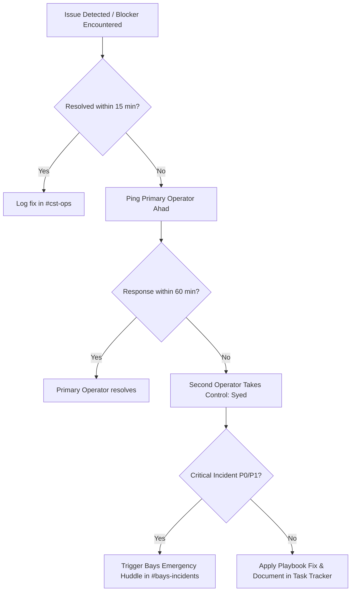

# Operator Playbook SOP — BAYS & CST Operations

**Loop:** `LOOP-1791848474090-Y5TW`
**Lane:** BAYS
**Owner / Primary Operator:** Ahad (`U0AC6RFNP3P`)
**Designated Second Operator:** Syed (`U0AC6SECOND`) / Backup: Jegan (`U0AC6JEGAN`)
**Status:** **DRAFT COMPLETE (IN REPOSITORY)** — Pending publication to Codex & BHARAG; pending Destiny's live simulation drill
**Last Updated:** 20 October 2026 (corrections + rollback/incident runbook + evidence-handling procedure)
**Codex Target:** Codex → SOPs → Engineering → `SOP-BAYS-OPERATOR-PLAYBOOK` (Pending Publication)
**BHARAG Ingestion Namespace:** `sop/bays-cst-operations` (Pending Ingestion)

> **Correction log — 2026-10-20.** Every path, command, and account handle in this SOP was re-verified against the repository and the Render API. Corrections are applied in place. The previously published values are recorded in §11 so the change history is not lost.
> - §3 `engine/src/adapters/vfarm_http_client.ts` → **`engine/src/adapters/vfarm/http_client.ts`** (the adapter is a directory module, not a flat file).
> - §3 `web/src/pages/Admin.tsx` → the Admin Console is **static HTML/JS**: `web/admin.html`, `web/admin.js`, `web/login.html`.
> - §3 migrations "`001_` through `018_`" → **`001_` through `019_`** (020 does not exist).
> - §3 / §2.2 tracker path `docs/release/task.md` → **`docs/task.md`** is the authoritative ledger (see §3.1).
> - §6 Area 1 `tests/test_helpers.ts` → shared helpers live in **`tests/helpers/`**.
> - §6 Area 3 `node scripts/migrate.js --dry-run` → **this flag does not exist.** `scripts/migrate.js` supports `--baseline`, `--force`, and `--rebaseline <file>`. A read-only inspection is `node scripts/migrate.js` (it skips already-recorded migrations and prints the ledger) — it does not mutate when the ledger is complete. Corrected in §6.
> - §8 Render admin handle `admin@bayshorizon.network` → **`admin@bhanetwork.org`** (authoritative: Render API `owner.email` for workspace `Bays' workspace`).
> - §2.2 handoff template "See docs/release/task.md" → **`docs/task.md`**.
> - **Added §11 Rollback & Incident Handling** and **§12 Evidence Collection & Sanitization** — both were required for operational handover and were missing.
> - **Added §6 Area 5 (Programmatic Voice API Guard) and the `CST_API_KEY` deployment precondition in §11.1** — the programmatic voice routes (`/api/v1/voice/turn`, `/api/v1/voice/synthesize`, `/api/v1/voice/status`, `/voice/turn`, `/audio/speak`) are behind a shared secret that **fails closed**. This is an operator-visible behaviour change: a deployment without `CST_API_KEY` leaves those five routes returning 503.

---

## 1. Purpose & Guiding Principles

This Standard Operating Procedure (SOP) ensures that Bays and the broader engineering team can seamlessly locate, understand, maintain, debug, and continue all operations owned by Ahad during absences, off-hours, or focused deep-work periods.

### Core Principles
1. **Zero Knowledge Silos**: Every critical system has a nominated second operator equipped with runnable commands, exact file paths, and troubleshooting checklists.
2. **Zero Secret Leakage**: Documentation details *where* credentials reside and how access is provisioned, but never stores passwords, tokens, API keys, or private keys.
3. **Escalation SLA**: Strict one-hour response threshold before cascading to team huddles.

---

## 2. Operator Availability & Handoff Communication

### 2.1 Daily Availability Window
- **Primary Window**: Monday through Friday, **09:00 – 09:45 EST** (18:00 – 18:45 PKT).
- **Format**: Dedicated synchronous window in Slack `#cst-sync` / Huddle for blocker triage, PR reviews, and architectural sign-offs.
- **Calendar & Slack Status**: Synced via Google Calendar `[CST Office Hours]` and Slack status emoji `💬 In Availability Window`.

### 2.2 Heads-Down Handoff Protocol
When entering heads-down deep work or scheduled leave:
1. Post a notice in `#cst-ops` using the standardized template:
   ```text
   🚨 [HANDOFF NOTICE] 🚨
   Primary Operator: Ahad (U0AC6RFNP3P)
   Status: Heads-Down / Out-of-Office (until YYYY-MM-DD HH:MM EST)
   Active Second Operator: Syed (U0AC6SECOND)
   Escalation Secondary: Jegan (U0AC6JEGAN)
    Active Branch / Tasks: See docs/task.md
    Live System Health: https://bha-cst-7u9e.onrender.com/health (200 OK)
    Escalation Path: 1h on-call ping -> Second Operator -> #bays-incidents huddle
    ```
2. Ensure `git status` is clean on `main` and untracked documentation is updated in `docs/release/`.

---

## 3. Work Inventory, Tooling & AI Assistant Connectivity

All source code, configuration, and documentation live in the unified workspace:

| Domain | Primary Repository / Path | Key Files / Subsystems |
|---|---|---|
| **CST Engine Core** | `bha-cst` (`/engine/src/core/`) | `engine/src/core/engine.ts`, `engine/src/router/index.ts` |
| **Transport & Messaging** | `bha-cst` (`/engine/src/transport/`) | Twilio webhooks, delivery status, Pakistan fallback route |
| **SMS Consent Spine** | `bha-cst` (`/engine/src/consent/`) | `engine/src/consent/service.ts`, `engine/src/consent/wording.ts` |
| **vFarm Adapters** | `bha-cst` (`/engine/src/adapters/vfarm/`) | `engine/src/adapters/vfarm/http_client.ts`, `engine/src/adapters/vfarm/live_client.ts`, `engine/src/connectors/vfarm.ts` |
| **Database Migrations** | `bha-cst` (`/db/migrations/`) | `scripts/migrate.js`, `scripts/migration_checks.js`, migrations `001_`–`019_` |
| **Admin Console** | `bha-cst` (`/web/`) | `web/admin.html`, `web/admin.js`, `web/login.html`, vFarm Users & Grants (Tab 10) |
| **Release & Evidence** | `bha-cst` (`/docs/`) | **`docs/task.md` (authoritative ledger)**, `docs/release/CST_MASTER_TASK_AUDIT.md`, readiness audits, verification records |

### 3.1 Authoritative records — read these first

| Record | Path | What it is |
|---|---|---|
| **Task & evidence ledger** | `docs/task.md` | The shareable record of every CST loop, decision watch, status label, blocker, owner, and approval. **This is the file to update after any work session.** |
| Master audit | `docs/release/CST_MASTER_TASK_AUDIT.md` | Full reconciliation of every loop against repository + production evidence. |
| Security audit (5R0J) | `docs/release/cst-5r0j-security-audit-and-residual-risk.md` | Auth model, live probe results, historical-exposure lineage, sign-off criteria. |
| KMG9 record | `docs/kmg9-verification-record.md` | Farm-routing fail-closed fix, what is locally proven vs externally unproven. |
| Operator Playbook | `docs/release/operator-playbook-sop.md` | This document. |

### 3.2 Normal operating procedure (start here)

Read-only health check — safe at any time, no mutation:

```bash
cd /path/to/customer\ twin          # repo root
git status --short                  # expect only intended changes
git log --oneline -5
npm run typecheck                   # expect exit 0
npm test                            # expect 618 passed / 6 skipped / 0 failed
curl -s https://bha-cst-7u9e.onrender.com/health   # expect {"status":"ok",...}
```

Production state — read-only via the authenticated Render CLI:

```bash
render deploys list srv-db8hepqvcj2c73adpus0            # top row = Live deploy SHA
render postgres get dpg-db8he2qvcj2c73ado3s0-a           # plan, expiresAt, ipAllowList
render logs -r srv-db8hepqvcj2c73adpus0 --limit 200      # recent service logs
```

**Standing rule:** `render deploys list` is the only authority for the deployed SHA. Never infer it from a document, a previous session, or a `/health` response.

### 3.3 Connecting an AI Assistant (Antigravity / Claude / Grok)
To orient an AI assistant in this repository:
1. Direct the assistant to read `AGENTS.md` and `docs/task.md`.
2. Workspace root is `/Users/HaMi/Documents/Jason/customer twin` (or repo clone root).
3. Primary commands to run for health verification:
   - Typecheck: `npm run typecheck`
   - Test suite: `npm test`
   - Build: `npm run build`
4. Assistant Guardrails: **Never commit directly without PR review, never expose credentials in chat, and never execute live mutations without explicit authorization**.

---

## 4. Responsibility Matrix & Second Operators

| Work Area / Action | Primary Owner | Second Operator | Fallback / Escalation |
|---|---|---|---|
| **Transport & Twilio Webhooks** | Ahad | Syed | Jegan |
| **Consent Spine & Opt-Outs** | Ahad | Syed | Jason |
| **vFarm Telemetry & Status Routing** | Ahad | Jegan | Jason |
| **Database Migrations & Ledger** | Ahad | Syed | Jegan |
| **Render Engine Deployment** | Ahad | Syed | Platform Admin |
| **Admin Panel (Tab 10 Grants)** | Ahad | Syed | Jason |

---

## 5. Single-Point-of-Failure Actions (Solo Permissions)

Certain operations are restricted to Ahad due to cryptographic access, environment isolation, or primary credential mapping:

| Restricted Action | Why Restricted | What Others Should Do Meanwhile |
|---|---|---|
| **Production Secret Rotation** | Cloud dashboard MFA tied to primary operator hardware key | Log incident in `#bays-incidents`; use Render dashboard emergency admin break-glass role if critical. |
| **Live Twilio Number Re-assignment** | Regulatory A2P campaign binding registered under primary account | Queue outbound messages; do not unbind numbers from service pool. |
| **Database Direct Allowlist Changes** | Render Postgres network ACL policy enforcement | Use read-only replica queries or dispatch query scripts via authorized CI runner. |

---

## 6. Common Blockers & Step-by-Step Fixes

### Area 1: Engine Test Suite or Typecheck Failure
- **Symptoms**: `npm run typecheck` fails with missing type definitions or `npm test` fails.
- **Diagnostic Step**:
  ```bash
  npm run typecheck
  npx vitest run tests/regression/kmg9_farm_isolation.test.ts
  ```
- **Fix**: Check `engine/tsconfig.json`. Ensure no circular dependencies were introduced between `engine/src/core/` and `engine/src/adapters/`. Confirm Vitest mocks in `tests/helpers/` are cleanly reset with `vi.clearAllMocks()`.

### Area 2: Inbound Twilio Webhook 403 / Signature Rejection
- **Symptoms**: Inbound SMS or voice calls receive HTTP 403 or Twilio debugger shows `11200 HTTP retrieval failure`.
- **Diagnostic Step**:
  Inspect logs for `SECURITY_LEDGER` entries containing `tool_or_route: "TwilioWebhookSignature"`.
- **Fix**:
  1. Confirm `TWILIO_AUTH_TOKEN` matches the configured Twilio project.
  2. Verify that reverse-proxy URL in Render matches the exact webhook URL set in Twilio console (including `https://` and trailing slash formatting).
  3. Ensure `X-Twilio-Signature` header is not stripped by CDN/Cloudflare proxy.

### Area 3: Database Migration Lock or Drift Error
- **Symptoms**: `node scripts/migrate.js` fails with `AdvisoryLockWaitTimeout` or `MigrationChecksumMismatch`.
- **Diagnostic Step**:
  ```bash
  # Read-only: prints the ledger, skips everything already recorded.
  # There is NO --dry-run flag. Do not add one to a production command.
  node scripts/migrate.js
  ```
  The runner's real flags are `--baseline` (adopt legacy databases that lack effect
  checks), `--force` (re-apply every file — **destructive, never run unapproved**),
  and `--rebaseline <file>` (accept a deliberate edit to an already-applied file —
  **requires owner approval**).
- **Fix**:
  1. If lock is held: Check if another migration runner crashed. Connect to Postgres and verify active advisory locks with:
     ```sql
     SELECT pid, locktype, mode, granted FROM pg_locks WHERE locktype = 'advisory';
     ```
  2. If checksum drift occurs: Never modify applied SQL files in `db/migrations/`. Create a forward migration (e.g. `020_*.sql`) to patch schema changes.
  3. **The duplicate `003` prefix warning is expected and harmless.** `003_add_customers_and_security_ledger.sql` and `003_customers_table.sql` are applied in filename order and recorded individually. **Do not rename them** and do not alter migration history.

### Area 4: vFarm Downstream Degraded / Timeout State
- **Symptoms**: Customer queries regarding farm status return "Telemetry unavailable" or lag.
- **Diagnostic Step**:
  Check logs for `[VfarmConnector]` error logs.
- **Verification of Fail-Closed Safety**:
  Verify CST returns `telemetry_unavailable` and **does NOT fall back to BHARAG cluster ask** (enforced by KMG9).
- **Fix**: Check `VFARM_API_BASE_URL` uptime. If vFarm is in maintenance, CST will automatically maintain fail-closed state without cross-tenant leakage.

---

### Area 5: Programmatic Voice Routes Return 503 (CST_API_KEY Not Configured)
- **Symptoms**: `POST /api/v1/voice/turn`, `/api/v1/voice/synthesize`, `/api/v1/voice/status`,
  `/voice/turn` and `/audio/speak` all return **503 `CONFIG_MISSING`**. The Twilio-signed
  voice and SMS webhooks, `/health` and the outbound worker keep working normally.
- **Cause**: `CST_API_KEY` is not set (or is empty) in the environment. The guard
  **fails closed by design** — it never falls back to an open route.
- **Diagnostic Step**:
  ```bash
  # The boot log states the gap once. Look for it in the service log.
  render logs -r srv-db8hepqvcj2c73adpus0 --text "CST_API_KEY" --limit 20
  ```
- **Fix**:
  1. Generate the secret once and store it in 1Password (`BHA Render Production Vault`):
     ```bash
     node -e "console.log(require('crypto').randomBytes(32).toString('hex'))"
     ```
  2. Set the **same** value as `CST_API_KEY` in the Render dashboard
     (`bha-cst` → Environment).
  3. Confirm the boot log no longer reports the missing configuration.
  4. **No restart is required** — the guard reads the environment on every request.
- **Notes**:
  - The engine deliberately **does not abort** when the secret is missing. Aborting
    would take the signed Twilio webhooks, the health endpoints and the outbound
    worker down with it, turning a misconfigured secret into a total outage
    instead of a closed door on five routes. The boot log and a `SECURITY_LEDGER`
    entry make the misconfiguration visible.
  - The Twilio-hosted equivalents of these routes are protected by **Twilio request
    signature verification** and do **not** use `CST_API_KEY`. Do not add the shared
    secret to a Twilio callback.


## 7. Escalation Protocol & SLAs



1. **T + 0 min**: Blocker identified; operator reviews Area 6 Playbook.
2. **T + 15 min**: If unresolved, ping Primary Operator (`@Ahad`) in Slack `#cst-ops`.
3. **T + 60 min**: If no response, Second Operator (`@Syed`) assumes authority.
4. **T + 90 min**: If production service is impacted (P0/P1), escalate to Team Huddle with Jason Bays and Destiny Arupi.

---

## 8. Access Management Directory (No Secrets)

| System / Platform | Login / Management Location | Admin Account Handle | Credential Location |
|---|---|---|---|
| **Render Cloud** | `dashboard.render.com` | Workspace `Bays' workspace` — owner `admin@bhanetwork.org` (verified via Render API 2026-10-20) | 1Password → `BHA Render Production Vault` |
| **Twilio Console** | `console.twilio.com` | Account SID: `AC***` | 1Password → `BHA Twilio Communications Vault` |
| **GitHub Repo** | `github.com/bhanetworkgh/bha_cst` | Organization: `bhanetworkgh` | SSH Deploy Keys / Personal Access Tokens in 1Password |
| **vFarm API Gateway**| `api.vfarm.internal` | Service Principal: `cst-engine` | 1Password → `BHA vFarm Service Vault` |
| **BHARAG Cluster** | `rag.bayshorizon.network` | Service Account: `cst-rag-client`| 1Password → `BHARAG Internal API Keys` |

---

## 9. Verification & Live Simulation Exercise (Destiny's Test)

To prove this SOP is operational and meets Destiny's acceptance criteria:
1. **Simulation Scenario**: Destiny initiates an unannounced drill in Slack: *"Ahad is unreachable. Inbound webhook signatures are failing on production. How do we triage and restore without leaking data?"*
2. **Success Criteria**:
   - Second operator (Syed) responds within 15 minutes.
   - Diagnoses root cause using Area 2 playbook (`SECURITY_LEDGER` signature validation).
   - Confirms fail-closed behavior without exposing secrets.
   - Escalates properly if unresolved within 60 minutes.
3. **Failure Criteria**:
   - Attempting to bypass signature validation in production.
   - Leaking credentials or API tokens in Slack.
   - Exceeding the 60-minute unassisted resolution SLA without escalation.
4. **Sign-off**: Destiny logs successful drill in `LOOP-1791848474090-Y5TW`.

---

## 10. Publication Checklist (Codex & BHARAG)

| Step | Target System | Action Required | Responsible Owner | Status |
|---|---|---|---|:---:|
| 1 | **Repository Draft** | Finalize 12-point SOP in `docs/release/operator-playbook-sop.md` | Ahad (`U0AC6RFNP3P`) | **COMPLETE** |
| 2 | **Codex Publication** | Publish markdown to Codex → SOPs → Engineering → `SOP-BAYS-OPERATOR-PLAYBOOK` | Destiny / Ahad | **PENDING** |
| 3 | **BHARAG Ingestion** | Ingest markdown into namespace `sop/bays-cst-operations` | Jegan / BHARAG Admin | **PENDING** |
| 4 | **Ingestion Verification** | Verify BHARAG semantic query: *"Who is the second operator for CST telemetry?"* returns Syed | Second Operator | **PENDING** |
| 5 | **Formal Acceptance** | Destiny logs acceptance on `LOOP-1791848474090-Y5TW` after successful simulation drill | Destiny Arupi | **PENDING** |

---

## 11. Rollback & Incident Handling (added 2026-10-20)

### 11.1 Rollback procedure — read before any deployment

The Render service is `srv-db8hepqvcj2c73adpus0`, branch `main`, `autoDeploy: yes` on commit.
**Consequence: a push to `main` is a production deployment.** There is no staging branch.

| Situation | Action | Authority |
|---|---|---|
| Bad deploy from a `main` push | Roll back in the Render dashboard: **Deploys → select the deploy → "Rollback to this deploy"**. This redeploys the previous commit and re-runs `node scripts/migrate.js` on startup. | Second operator may roll back **only** for a confirmed P0 (outage, data exposure, or a stuck outbound worker). Log it in `#bays-incidents` immediately. |
| Migration caused the breakage | A rollback does **not** undo a migration. Migrations are forward-only. Fix forward with a new `NNN_*.sql` file, and never edit an already-applied migration. | Ahad or Platform Admin. |
| Schema needs reverting | Requires an explicit forward migration that reverses the effect. Do **not** hand-write destructive DDL in a terminal. | Ahad + Platform Admin approval. |
| DB plan expiry (2026-11-14) | Not a rollback case — see `docs/release/cst-database-continuity-plan.md` (pre-flight `pg_dump`, 5–10 min cutover, validation SQL, rollback steps). | Jason Bays approves cost and window. |

**Pre-deployment checklist (run before any `main` push):**

```bash
npm run typecheck && npm test && npm run build && git diff --check
render deploys list srv-db8hepqvcj2c73adpus0     # note the current Live SHA
git log --oneline 3e88058..HEAD                   # what will be deployed
ls db/migrations/                                 # any new migration in this push?
```

**Precondition — `CST_API_KEY` must be set BEFORE deploying a build that contains
the programmatic voice guard.** The guard fails closed: if the variable is absent
or empty, the five programmatic voice routes return **503 `CONFIG_MISSING`**. The
engine still boots and every other route keeps working, but the programmatic
voice API is closed until the secret is set. Confirm it is present before the
push:

```bash
# The secret's VALUE is never printed. This only proves the boot log no longer
# reports the gap.
render logs -r srv-db8hepqvcj2c73adpus0 --text "CST_API_KEY" --limit 20
```

If the push includes a migration, read its SQL end-to-end and confirm it is
idempotent (`IF NOT EXISTS` / `COALESCE` / guarded `WHERE`) and scoped to the
intended rows. Migration 019 is the reference example: a single guarded `UPDATE`
on one `project_id`.

**Do not** use `render services update` to set environment variables — it edits
service configuration. Environment variables are set in the Render dashboard.

### 11.2 Incident severity and immediate actions

| Sev | Definition | First action | Notify |
|---|---|---|---|
| **P0** | Outage, cross-tenant data exposure, or farm-key/admin-JWT compromise suspected | Contain first: if a credential is suspected compromised, **do not rotate in a hurry** — preserve the evidence, then rotate. Pull the last 500 log lines, then escalate. | `#bays-incidents` + Jason + Destiny immediately, 24/7 |
| **P1** | Degraded channel (voice or SMS not delivering), consent enforcement not firing, migration drift | Identify the failing layer with §6 Areas 1–4. Do not disable the failing check to make traffic flow. | Ahad within 15 min; Jason within 60 min |
| **P2** | Local build/test failure, documentation drift, non-blocking defect | Fix locally, add a test, update `docs/task.md` | Next availability window |

**Absolute rules during an incident:**

1. **Never** weaken authentication, Twilio signature verification, consent checks, role permissions, DID/project bindings, or voice-clone isolation to restore traffic.
2. **Never** delete or edit audit rows. `sms_consent_audit` is append-only by trigger; `SECURITY_LEDGER` entries are the incident's primary evidence.
3. **Never** disable the outbound worker's consent gate to clear a queue. A blocked SMS is the consent spine working correctly.
4. **Never** edit an applied migration file.
5. Escalate on time rather than escalating late — a 60-minute SLA breach is itself an incident.

---

## 12. Evidence Collection & Sanitization (added 2026-10-20)

Evidence is what turns "we think it works" into "it works, here is the proof". Every
status claim in `docs/task.md` must point at one of the forms below.

### 12.1 What counts as evidence, by claim type

| Claim | Required evidence | NOT evidence |
|---|---|---|
| Code behaves correctly | Command + exit code + test file + count, with the date run | "The code looks right" |
| Production is healthy | Render CLI output (`render deploys list`, `render postgres get`) or a live HTTP status | A `/health` 200 alone (it proves the process is up, not which commit) |
| A specific commit is deployed | `render deploys list` showing it as `Live` | `git log`, a document, a previous session's note |
| Schema exists in the DB | A `SELECT` result from `information_schema`/`pg_catalog` run by an authorized operator | The migration ledger line — a ledger entry is a *record of intent*, not proof of the object |
| A message was delivered | Provider message ID (`SM…`) **and** a delivery-status callback row | HTTP 200 from the send call |
| A call succeeded | Twilio Call SID **and** a persisted transcript **and** the server log line | HTTP 200 from the webhook, or a simulated request |
| A customer-facing flow works | Real handset / real customer interaction, witnessed | A unit test, a mock, a dry run |

### 12.2 Read-only evidence commands

```bash
# Deployed state
render deploys list srv-db8hepqvcj2c73adpus0
render postgres get dpg-db8he2qvcj2c73ado3s0-a -o json

# Service logs (note the measured retention ceiling: CLI reaches back only ~2 days)
render logs -r srv-db8hepqvcj2c73adpus0 --limit 500
render logs -r srv-db8hepqvcj2c73adpus0 --path "/api/devices,/api/farms" --status-code "200,304" --limit 200

# Local verification
npm run typecheck && npm test && npm run build && git diff --check
```

### 12.3 Sanitization rules — mandatory before anything is shared

1. **Never** include in a document, Slack message, ticket, or commit: passwords, tokens, API keys, private keys, `DATABASE_URL`, `Authorization` header values, `X-Farm-Key`, `X-Admin-Token`, Twilio auth tokens, ElevenLabs API keys.
2. **Mask** phone numbers and customer identifiers: keep the last 2–4 digits only, e.g. `+9230…8444`. Keep customer `customer_ref`/`person_id` as-is only if they are test fixtures (`cust_…`, `usr_…`); real identities must be pseudonymised.
3. **Never** paste a raw farm key, even partially — mask it as `HM…7se` at most, and prefer not to show any fragment.
4. **Never** export raw production logs wholesale. Extract only the lines that prove the specific claim, and redact any token-like substring first.
5. **Do not** run queries that mutate production. `SELECT` only. If a query needs a write to be useful, that is a change request, not evidence collection.
6. **When in doubt, redact.** A redacted log that proves the claim is better evidence than a complete log that leaks a credential.

### 12.4 Recording evidence in the ledger

Every work session appends to `docs/task.md` §E (Change and verification log):

```
UTC timestamp | files inspected/changed | exact commands + exit codes |
test/build/typecheck results | git diff & working-tree impact |
external evidence checked | actions NOT performed because approval was missing
```

Keep the main ledger concise and **link** to detailed evidence reports under
`docs/release/` rather than pasting long logs into it.
