# CST — Jason A–F Acceptance Gap Closure, Production Verification & Consolidated Evidence Report

> **Authoritative Primary Master Report**  
> **Repository:** `bhanetworkgh/bha_cst`  
> **Branch:** `fix/monitoring-pay-gate-closure`  
> **HEAD SHA:** `ea59fc33c5312e35817abad76a53b75918d3b756`  
> **Date:** 2026-11-03  
> **Target Production Environment:** `https://bha-cst-7u9e.onrender.com` (`bha-cst`, Render Service `srv-db8hepqvcj2c73adpus0`, Region `oregon`)  
> **Target Production Database:** `bha-cst-postgres` (`dpg-db8he2qvcj2c73ado3s0-a`, DB: `bha_cst_1sh0`, User: `bha_cst_user`, PostgreSQL 16)  
> **Verified Deployed Production Commit:** `441d2b3f4a49c983f45131c229888a60116b9437` (PR #23 Merge Commit, Deployment `dep-dbkh3p6417fc73bffihg`, live at `2026-11-02T22:43:32.077742Z`)  
> **Decision Watch Reference:** `DW-1793626498819-PDQ2`  
> **Incident Reference:** `LOOP-1793620799001-3NBE`

---

## 1. Executive Summary

This authoritative report consolidates the complete engineering, testing, architectural, and production evidence for the six outstanding CST acceptance items (**A through F**) identified in Ahad's review.

Every finding in this report has been re-evaluated against the running codebase, automated test suites (111 test files, 1,160 tests passing), direct read-only inspection of the Render PostgreSQL 16 database (`dpg-db8he2qvcj2c73ado3s0-a`), live production container logs, and the 111-endpoint production test results on deployment `dep-dbkh3p6417fc73bffihg`.

### Core Engineering Findings
1. **Item A (Monitoring Health Semantics & Sensors):** All 4 canonical sensors (`rack1_soil`, `rack1_ph`, `rack2_dht`, `rack1_mq7`) stream fresh (<60s old), calibrated live data via the interim endpoint (`/api/v1/readings?sensor_id=X&limit=1`). The interim endpoint is a transitional compatibility mechanism; authoritative `/readings/latest` remains blocked on upstream database indexing. The test-harness discrepancy identified by Ahad (`curl -m 12` vs CST's 30s timeout) has been corrected in [scripts/test-prod-all-endpoints.sh](../../scripts/test-prod-all-endpoints.sh) and unit-tested in [tests/adapters/vfarm_live_contract.test.ts](../../tests/adapters/vfarm_live_contract.test.ts).
2. **Item B (Field Contract & Help Copy):** The formal field contract has been consolidated in [docs/contracts/monitoring-research-twin-field-contract.md](../../docs/contracts/monitoring-research-twin-field-contract.md), defining every field's data type, units, nullability, timestamp semantics, freshness bounds, source of truth, and tenant scope. Customer-facing help copy in [docs/help/p1-vfarm-status-and-monitoring-help-copy.md](../../docs/help/p1-vfarm-status-and-monitoring-help-copy.md) has been aligned.
3. **Item C (Customer Experience Acceptance):** Browser chat and voice routing implementations are verified in code, database, and local tests. Live human browser chat and live inbound phone calls (`+19715885823`) remain pending authorized human execution.
4. **Item D (Research Twin Integration):** Render credentials (`RT_ENDPOINT_URL`, `RT_SERVICE_API_KEY`, `RT_CALLBACK_SIGNING_SECRET`) are verified configured. CST enforces a fail-closed boundary (`state: "blocked"`, `contract: "unverified"`), awaiting Destiny Arupi's wire schema confirmation and one signed callback round-trip.
5. **Item E (Delivery Attribution & Telephony Evidence):** Historical database proof from 2026-10-30 verifies Twilio outbound SMS callback delivery (`SMdd413c99025787c3a92c9a7c5e91de77`, `SMd9ecf40685cc36db7d184ec776dc0afb`) and ElevenLabs TTS audio synthesis across CallSIDs (`CA00c75d6e31e3e604e542f4ef05efbeb8`, `CAe444cd581967be81a5bbdb8eb0c55168`). Fresh post-PR #23 live SMS turns and call verification remain pending authorized human testing.
6. **Item F (Migrations & npm Audit Exception):** All 24 migration files (`001`–`023`) are verified applied in production PostgreSQL with matching SHA-256[0..32] checksums. A formal security exception has been drafted for the 3 moderate `swagger-jsdoc` transitive dependencies (`glob`, `minimatch`), awaiting risk owner approval.

---

## 2. Final Pay-Eligibility Assessment

**Current Recommendation:** **`NOT READY — EXTERNAL OR ENGINEERING EVIDENCE REQUIRED`**

CST cannot be declared pay-eligible at this time. While CST's internal code, database schema migrations, and interim telemetry retrieval are operating cleanly in production, pay-gate closure is blocked by:
1. Upstream vFarm database composite indexing required for authoritative reading and statistics endpoints (Owner: Jeganathan).
2. Upstream farm health semantics returning undefined `"neutral"` status with null timestamps (Owner: Jeganathan).
3. Research Twin request/response schema confirmation and signed callback verification (Owner: Destiny Arupi).
4. Authorized human browser-chat and live voice acceptance testing (Owner: Jason / Authorized Tester).
5. Fresh post-PR #23 live SMS delivery attribution execution (Owner: Jason / Authorized Tester).
6. Security risk acceptance sign-off for the npm audit exception (Owner: Security Owner / CST Ops).

The Decision Watch `DW-1793626498819-PDQ2` must remain open until these external and human proofs are supplied.

---

## 3. Consolidated Acceptance Matrix A–F

| Item | Requirement | Implementation Status | Automated Local Proof | Production Proof (`dep-dbkh3p6417fc73bffihg`) | External Dependency | Final Status |
|---|---|---|---|---|---|---|
| **A** | Monitoring semantics, freshness, authoritative endpoints, CI | Interim endpoint implemented; authoritative fallback configured | `tests/adapters/vfarm_interim_readings.test.ts`, `tests/adapters/vfarm_live_contract.test.ts` (PASS) | Tests #45–#46, #48–#49, #51–#52, #54–#55, #61, #65 return **HTTP 200 OK (<600ms) with fresh (<60s) live data** | Jeganathan (vFarm composite index on `readings(sensor_id, reading_ts DESC)`) | **`BLOCKED EXTERNAL`** |
| **B** | Field contract and help copy | Field contract established; help copy aligned | [docs/contracts/monitoring-research-twin-field-contract.md](../../docs/contracts/monitoring-research-twin-field-contract.md), `tests/core/help_menu_copy.test.ts` (PASS) | Contract verified in repository; customer help copy reflects live vs interim boundaries | None (CST-owned documentation and schema alignment complete) | **`PASS`** |
| **C** | Browser chat and voice acceptance | Conversational engine, Twilio voice lane, ElevenLabs TTS integrated | `tests/core/engine.test.ts`, `tests/voice/voice_lifecycle.test.ts` (PASS) | DB migration `023` applied; `systems.onboarding_reply` verified; `GET /health/voice` returns `200 OK` (`can_route_voice: true`) | Jason / Authorized Tester (execute Browser Chat and live call to `+19715885823`) | **`PENDING HUMAN ACCEPTANCE`** |
| **D** | Research Twin contract and signed callback | Fail-closed connector implemented; HMAC-SHA256 signature verification active | `tests/research_twin/config.test.ts`, `tests/research_twin/lifecycle.test.ts` (PASS) | Render startup logs (`22:43:26Z`) & `GET /api/health` confirm credentials configured (`missing: []`, `state: "blocked"`) | Destiny Arupi (wire schema confirmation and 1 signed test callback) | **`BLOCKED EXTERNAL`** |
| **E** | Fresh SMS/voice attribution and dashboard | Outbound delivery worker, status callback handler, dashboard publisher active | `tests/transport/delivery_persistence.test.ts`, `tests/publishers/turn_event_contract.test.ts` (PASS) | Production DB verified: Historical records from 2026-10-30 show 2 delivered SMS (`SMdd41...`, `SMd9ec...`) and ElevenLabs TTS audio synthesis rows; #20, #21, #41 `200 OK` | Jason / Authorized Tester (authorized destination phone & consent for post-PR #23 live SMS turn) | **`PENDING LIVE VERIFICATION`** |
| **F** | Production migrations and npm audit exception | Migrations 001–023 verified applied; npm audit exception documented | `scripts/migrate.js`, `tests/db/schema_assertions.test.ts` (PASS) | Production DB `dpg-db8he2qvcj2c73ado3s0-a` verified with 24 applied migrations; `npm audit` shows 3 moderate in `swagger-jsdoc` | Security Owner / CST Ops (risk exception approval and review date) | **`BLOCKED EXTERNAL`** |

---

## 4. Item A — Monitoring Health Semantics, Freshness, Authoritative Endpoints & CI

### 4.1 Canonical Sensors Production Status
All four canonical vertical farm sensors stream fresh, real-world physical telemetry in production deployment `dep-dbkh3p6417fc73bffihg`:

| Sensor ID | Hardware Device Type | Observed Physical Metric | Production Value (`dep-dbkh3p6417fc73bffihg`) | Reading Age | Freshness Status | Calibration Status |
|---|---|---|---|---|---|---|
| `rack1_soil` | Capacitive Soil Moisture Sensor | Volumetric Water Content | **`90.0 %`** | `< 60 seconds` | **`FRESH`** | Nominal |
| `rack1_ph` | Industrial Glass Electrode Probe | Acidity / Alkalinity | **`5.06 pH`** | `< 60 seconds` | **`FRESH`** | **`CALIBRATED`** (Corrected from raw uncalibrated `25.19 pH`) |
| `rack2_dht` | DHT22 Temperature & Humidity | Air Temperature & RH | **`28.8 °C / 63.0 % RH`** | `< 60 seconds` | **`FRESH`** | Nominal |
| `rack1_mq7` | Semiconductor Gas Sensor | Carbon Monoxide Concentration | **`0.76 ppm`** | `< 60 seconds` | **`FRESH`** | Nominal |

### 4.2 Authoritative vs Interim Endpoints Verification Matrix
The table below documents the exact contract, upstream behavior, and root-cause classification for all monitored endpoints:

| Endpoint Path | Expected Contract | Actual Status | Latency | Data Freshness | Auth Mode | CST Handling | Upstream Behavior | Classification | Owner | Evidence Reference |
|---|---|---|---|---|---|---|---|---|---|---|
| `GET /api/v1/admin/vfarm/readings?sensor_id=rack1_soil&limit=1` | Array of readings envelopes | **`200 OK`** | `573 ms` | `< 60s` | `x-admin-token` | Returns latest reading | Responds via indexed limit query | **`PASS`** | CST | Test #46, Run 4 |
| `GET /api/v1/admin/vfarm/readings?sensor_id=rack1_ph&limit=1` | Array of readings envelopes | **`200 OK`** | `494 ms` | `< 60s` | `x-admin-token` | Returns latest reading | Responds via indexed limit query | **`PASS`** | CST | Test #49, Run 4 |
| `GET /api/v1/admin/vfarm/readings?sensor_id=rack2_dht&limit=1` | Array of readings envelopes | **`200 OK`** | `529 ms` | `< 60s` | `x-admin-token` | Returns latest reading | Responds via indexed limit query | **`PASS`** | CST | Test #52, Run 4 |
| `GET /api/v1/admin/vfarm/readings?sensor_id=rack1_mq7&limit=1` | Array of readings envelopes | **`200 OK`** | `526 ms` | `< 60s` | `x-admin-token` | Returns latest reading | Responds via indexed limit query | **`PASS`** | CST | Test #55, Run 4 |
| `GET /api/v1/readings/latest` | Single latest reading object | **`503 / 504`** | `> 6,000 ms` | Stale / N/A | `Bearer JWT` | Times out, falls back to interim | Times out; exhausts upstream DB pool | **`BLOCKED EXTERNAL`** | Jeganathan (vFarm) | Upstream issue #47 |
| `GET /api/v1/admin/vfarm/readings/stats?sensor_id=X&window=24h` | Aggregated min/max/avg | `502 / 000` | `> 12,000 ms` | N/A | `x-admin-token` | Bounded by 30s timeout | Unindexed scan across 6.71M+ rows | **`BLOCKED EXTERNAL`** | Jeganathan (vFarm) | Tests #47, #50, #53, #56 |
| `GET /api/v1/admin/vfarm/system-stats` | Platform totals | `503 / 000` | `> 12,000 ms` | N/A | `x-admin-token` | Bounded by 60s timeout | Full-table sequential count scan | **`BLOCKED EXTERNAL`** | Jeganathan (vFarm) | Test #42, Run 4 |
| `GET /api/v1/admin/vfarm/alerts/counts` | Alert count buckets | `422 Unprocessable` | `1,303 ms` | N/A | `x-admin-token` | Propagates 422 error | FastAPI router misorders path parameters | **`BLOCKED EXTERNAL`** | Jeganathan (vFarm) | Test #43, Run 4 |
| `GET /api/v1/farms` | Farm array | **`200 OK`** | `1,069 ms` | Fresh | `x-admin-token` | Lists active farms | Responds with 2 farms | **`PASS`** | CST | Test #65, Run 4 |
| `GET /api/v1/devices` | Device fleet array | **`200 OK`** | `904 ms` | Fresh | `x-admin-token` | Lists 23 devices | Responds with device status | **`PASS`** | CST | Test #61, Run 4 |

### 4.3 Interim vs Authoritative Contract Clarification
> [!IMPORTANT]
> **Interim Compatibility Designation:** The interim reading endpoint (`/api/v1/readings?sensor_id=X&limit=1`) is **a transitional compatibility mechanism**, NOT the approved permanent contract. CST implemented this fallback in [adapters/vfarm/live_client.ts](../../engine/src/adapters/vfarm/live_client.ts) to prevent customer-facing chat and voice lanes from timing out while upstream vFarm fixes its database performance. The authoritative production target remains `/api/v1/readings/latest`. CST will not deprecate the fallback until vFarm verifies `< 500ms` response times on `/api/v1/readings/latest`.

### 4.4 Test-Harness Timeout Correction
- **Discrepancy Root Cause:** The test script [scripts/test-prod-all-endpoints.sh](../../scripts/test-prod-all-endpoints.sh) hardcoded `curl -m 12` (12-second abort) on all requests. For reading statistics (`/readings/stats`), CST's internal timeout is `VFARM_READINGS_STATS_TIMEOUT_MS = 30000` (30 seconds). When upstream vFarm took >12s, curl aborted with exit status 28 (`CUR_STATUS="000"`), recording a `FAIL` before CST's 30-second budget expired.
- **Harness Correction Implemented:**
  1. Updated `run_request()` in [scripts/test-prod-all-endpoints.sh](../../scripts/test-prod-all-endpoints.sh) to accept an optional timeout parameter: `req_timeout_sec="${6:-12}"`.
  2. For the four reading statistics tests (#47, #50, #53, #56), the harness now allocates a **35-second budget** (`35`), allowing CST's 30s timeout to complete cleanly.
  3. Added explicit classification: if curl still aborts at 35s, it reports `FAIL (Client timeout at 35s exceeded CST 30s budget)`. If CST returns HTTP 502/504, it correctly classifies as `DEGRADED (Upstream vFarm stats timeout > 30000ms)`.
  4. Added regression unit test in [tests/adapters/vfarm_live_contract.test.ts](../../tests/adapters/vfarm_live_contract.test.ts) verifying that `getReadingStats()` applies `VFARM_READINGS_STATS_TIMEOUT_MS = 30000`.

### 4.5 Health Semantics & Fail-Safe Verification
- **Cold-Boot Health Probe Behavior:** On fresh container startup, `getHealth()` uses static environment variable `VFARM_JWT` (which expired on `2026-10-23T20:05:24Z`). vFarm rejects the probe with HTTP 401, resulting in `api_reachability.status: "unavailable", reason: "probe_failed:auth"` (Test #3 `DEGRADED`).
- **Warm Probe Behavior:** Once admin routes execute `ensureAdminToken()`, CST acquires and caches dynamic JWT credentials (`this.adminJwt`). Subsequent probes return `api_reachability.status: "healthy"` (`889ms`), but `farm_health.status: "degraded"` because upstream vFarm (`/api/v1/farms/{id}/health`) returns `raw_status: "neutral"` and null timestamps.
- **Fail-Safe Principle:** CST never invents a `healthy` status when upstream data is unavailable, unrecognized, or unauthenticated. Unrecognized statuses strictly map to `degraded` or `unknown`.

### 4.6 CI & Local Test Verification
- **CI Provider Status:** There is **no `.github/workflows` directory** configured in this repository. CI runs are not automated on GitHub Actions.
- **Local Verification Evidence:**
  - `npm test`: **111 test files passed, 1,160 tests passed, 6 skipped** (0 failed).
  - `npm run typecheck`: TypeScript compilation clean (`tsc --noEmit -p engine/tsconfig.json`, exit code 0).
  - `npm run build`: Project build clean (`tsc -b engine/tsconfig.json && node scripts/copy_web_assets.js`, exit code 0).

---

## 5. Item B — Monitoring and Research Twin Field Contract (v1.1.1), Help Copy & Web UI Verification

### 5.1 Field Contract v1.1.1 Consolidation & Diff from v1.1.0
The formal field contract is located in [docs/contracts/monitoring-research-twin-field-contract.md](../../docs/contracts/monitoring-research-twin-field-contract.md). It has been updated to **Contract Version 1.1.1** to resolve all ambiguities raised in Decision Watch `DW-1793626498819-PDQ2`.

#### Key Diff: Contract v1.1.0 vs v1.1.1
1. **Resolution of `/api/v1/farms/health` vs `/api/v1/farms/{id}/health`:**
   - **Upstream Reality:** In `.openapi-vfarm.json`, vFarm only defines `GET /api/v1/farms/{farm_id}/health`. There is **no** unparameterized endpoint `/api/v1/farms/health` upstream.
   - **CST Architecture:** CST's `/api/health` probes overall service health and active farm health via `GET /api/v1/farms/{active_id}/health`. Every internal or external route querying farm health must provide an explicit `farm_id`. Unparameterized calls return 400 or 403.
2. **User-to-Farm Access Rules (403 Forbidden vs 404 Not Found):**
   - **`403 Forbidden`:** Returned when the caller is authenticated, but does not own or have an active grant for the target `farm_id`. Enforced by `assertSpeakerFarmAccess()` which throws `VfarmAuthorizationError` (`AUTH_FORBIDDEN`).
   - **`404 Not Found`:** Returned when the requested `farm_id` does not exist in vFarm's database or device registry.
   - CST never returns 404 for permission denial, nor 403 for non-existent entities.
3. **Four-State Health Taxonomy (NORMAL / DEGRADED / OFFLINE / UNKNOWN):**
   - **`NORMAL`:** Upstream healthy, all 4 canonical sensors fresh (<15m), devices online.
   - **`DEGRADED`:** Telemetry stale (>15m to 24h), out-of-range sensor readings, null calculation timestamps, or upstream neutral/degraded status.
   - **`OFFLINE`:** Hardware/gateway unreachable (>1h), or upstream device fleet_status is `offline`. Note: Loads that are `off` are NOT offline.
   - **`UNKNOWN`:** Cold container boot, unauthenticated upstream probe, missing farm ID, or communication timeout.

### 5.2 Customer Help-Copy & State Response Discipline
Customer-facing help documentation in [docs/help/p1-vfarm-status-and-monitoring-help-copy.md](../../docs/help/p1-vfarm-status-and-monitoring-help-copy.md) has been fully aligned with Contract v1.1.1:
- **`NORMAL`:** CST says all monitored sensors are within operational limits. CST will **NOT** claim unmonitored devices or general plant biology are 100% fine, nor fabricate missing telemetry.
- **`DEGRADED`:** CST says telemetry is stale or sensors have breached limits. CST will **NOT** claim the farm is fine, nor substitute artificial defaults.
- **`OFFLINE`:** CST says hardware has stopped emitting packets. CST will **NOT** describe switched-off loads (`off`) as offline, nor report structural frames (`VFARM-CAB-001`) as offline devices.
- **`UNKNOWN`:** CST says status cannot be verified with upstream vFarm. CST will **NOT** assume healthy by default, nor present unverified cache as live telemetry.
- **Five-Minute Rule Warning:** CST passes through vFarm's authoritative `fleet_status`; the five-minute presence calculation is blocked pending Jeganathan's confirmation.
- **Known Upstream Defect Warning:** `NEVER_HEARD_DEVICE_FALSE_ONLINE` warning explicitly documented.

### 5.3 Web UI Authentication & vFarm Linking Verification
Direct testing on live production `https://bha-cst-7u9e.onrender.com` confirms strict authentication and vFarm linking:
1. **Unauthenticated Access Blocked:**
   - Request: `curl -s -i https://bha-cst-7u9e.onrender.com/api/v1/admin/vfarm/organizations`
   - Response: `HTTP/2 401 UNAUTHORIZED`
   - Body: `{"error":"UNAUTHORIZED","message":"Admin authentication required. Please log in at /admin."}`
2. **Invalid Credentials Blocked:**
   - Request: `POST /api/v1/auth/login` with `{"email":"bad@example.com","password":"wrong"}`
   - Response: `HTTP/2 401 UNAUTHORIZED`
   - Body: `{"error":"UNAUTHORIZED","message":"Invalid email or password"}`
3. **Valid Authentication via Web UI Login (`web/login.html`):**
   - Request: `POST /api/v1/auth/login` with seeded credentials (`admin@cst.com` / `admin`)
   - Response: `HTTP/2 200 OK`
   - Body: `{"status":"ok","token":"24bcedfddd9405786ec8463d34633c3fd1dc1760f37e163b823cc9b4fbb7a5db","email":"admin@cst.com","name":"CST Super Admin"}`
4. **vFarm Linking via Authenticated Web UI:**
   - Discovery of vFarm Organizations: `GET /api/v1/admin/vfarm/organizations` returns `HTTP 200 OK` with organization `122d8fb6-f4d3-42e9-b0d6-f2f80a6c276d` (`slug: "default"`, 2 farms, 2 members).
   - Discovery of vFarm Customers & Farm Grants: `GET /api/v1/admin/vfarm/customers?org_id=122d8fb6-f4d3-42e9-b0d6-f2f80a6c276d` returns `HTTP 200 OK` with user `ahad@bhanetwork.org` linked to farm grants for `21dde23e-f7f6-46bc-9b54-e97fabaaafd7` and `ed95e120-74c4-4126-a2e9-0e4ffa9275e6`.


---

## 6. Item C — Customer Experience Acceptance (Chat & Voice)

### 6.1 Automated Architectural Verification
1. **Voice Routing & ElevenLabs TTS:** Verified via `GET /health/voice` on deployment `dep-dbkh3p6417fc73bffihg`:
   ```json
   {
     "status": "healthy",
     "can_route_voice": true,
     "voice_id": "Hmy97GCI840wuICQesiM",
     "latency_ms": 462
   }
   ```
2. **Conversational Greeting & Help Copy:** Verified in PostgreSQL `systems.onboarding_reply` and automated tests (`tests/core/help_menu_copy.test.ts` PASS):
   - Greeting: *"Hi, thanks for calling vFarm Support. I'm here to help. What would you like to check today?"*
   - Help: *"I can check your farm's temperature, humidity, soil moisture, pH, or air quality, review recent alerts, or connect you with a specialist. Just tell me what you'd like to check."*

### 6.2 Human Acceptance Test Procedures
Live human acceptance is documented in [docs/reports/CST_Human_Acceptance_Test_Plan.md](../../docs/reports/CST_Human_Acceptance_Test_Plan.md) and requires execution by an authorized tester:

#### Test Suite 1: Browser Chat Verification
| Step | Action | Expected Output | Classification |
|---|---|---|---|
| 1 | Open `https://bha-cst-7u9e.onrender.com/web` | Chat UI renders cleanly | `PENDING HUMAN ACCEPTANCE` |
| 2 | Send: `"Hi"` | Conversational onboarding greeting plays without menu numbers | `PENDING HUMAN ACCEPTANCE` |
| 3 | Send: `"How are the sensors on my cabinet doing?"` | Summarizes fresh readings: soil 90%, pH 5.06, temp 28.8°C, humidity 63%, CO 0.76 ppm | `PENDING HUMAN ACCEPTANCE` |
| 4 | Send: `"I need to speak with a human technician"` | Escalation row created in `escalations` table (`022`), Slack notification dispatched | `PENDING HUMAN ACCEPTANCE` |

#### Test Suite 2: Inbound Voice Call Verification (`+19715885823`)
| Step | Action | Expected Output | Classification |
|---|---|---|---|
| 1 | From authorized handset, dial `+19715885823` | Call connects, Twilio webhook authenticates | `PENDING HUMAN ACCEPTANCE` |
| 2 | Listen to greeting | Natural ElevenLabs voice (`Hmy97GCI840wuICQesiM`) speaks greeting | `PENDING HUMAN ACCEPTANCE` |
| 3 | Speak: *"What is the current temperature and soil moisture?"* | Spoken answer reports ~28.8°C and ~90% moisture | `PENDING HUMAN ACCEPTANCE` |
| 4 | Hang up | `voice_deliveries` records turn synthesis and lane dispatch | `PENDING HUMAN ACCEPTANCE` |

---

## 7. Item D — Research Twin Integration and Signed Callback

### 7.1 Production Configuration Status
Render environment variables are confirmed populated on deployment `dep-dbkh3p6417fc73bffihg`:
- `RT_ENDPOINT_URL`: Configured
- `RT_SERVICE_API_KEY`: Configured
- `RT_CALLBACK_SIGNING_SECRET`: Configured

Startup logs at `2026-11-02T22:43:26.799Z` and `GET /api/health` confirm:
```json
"research_twin": {
  "state": "blocked",
  "operational": false,
  "contract": "unverified",
  "endpoint_configured": true,
  "service_api_key_configured": true,
  "callback_signing_secret_configured": true,
  "missing": [],
  "reason": "approved Research Twin API and callback contract is not verified"
}
```

### 7.2 Cryptographic Webhook & Callback Contract
1. **Outbound Dispatch:** POST to `RT_ENDPOINT_URL` with header `X-Service-Key: $RT_SERVICE_API_KEY`.
2. **Inbound Callback:** Inbound webhook at `/webhooks/research-twin/callback`.
3. **Signature Validation:** Header `X-RT-Signature` must contain `HMAC-SHA256(request_body, RT_CALLBACK_SIGNING_SECRET)`.
4. **Replay Protection:** Payload `timestamp` must be within 300 seconds of current UTC. Replayed or expired timestamps return HTTP 401.
5. **Fail-Closed Boundary:** CST refuses to emit unverified requests until Destiny Arupi provides wire contract sign-off and executes one signed callback round-trip.

---

## 8. Item E — Fresh SMS Attribution & Dashboard Evidence

### 8.1 Technical Distinction of Telephony Statuses
To prevent conflating separate operational stages, the following statuses are independently tracked:
1. **SMS Provider Status (`delivered`):** Confirmed delivery callback received from Twilio via `/webhooks/twilio/delivery-status` for outbound SMS.
2. **ElevenLabs Status (`synthesized`):** Confirmed successful TTS audio buffer synthesis via the ElevenLabs API (`voice_id: Hmy97GCI840wuICQesiM`, `model_id: eleven_turbo_v2_5`).
3. **Voice Lane Status (`sent`):** Confirmed internal CST voice lane dispatch of synthesized turn audio into Twilio's audio websocket stream.
4. **Completed Twilio Call Outcome:** Terminal call outcomes (e.g. user answered, terminal call duration, Twilio `completed` call webhook) are **NOT** recorded in `voice_deliveries`, which stores turn-level synthesis and dispatch rows. Terminal call completion requires live human test verification.

### 8.2 Historical Database Proof (2026-10-30 Predating PR #23)
Direct read-only inspection of production PostgreSQL (`dpg-db8he2qvcj2c73ado3s0-a`) retrieved the following exact records:

#### Outbound SMS Delivery Evidence (`messages_out`)
| Outbound Message ID | Provider Message SID (`provider_sid`) | Inbound Turn SID (`turn_id`) | Route | Provider Status | Delivery Timestamp (UTC) |
|---|---|---|---|---|---|
| `out_b556d753-4a7f-43f0-9c4d-cb9bdcedd38b` | **`SMdd413c99025787c3a92c9a7c5e91de77`** | **`SMf9470b51719bb4512a93dfab83fa8464`** | `+19715885823` -> `+9230***3844` | **`delivered`** | `2026-10-30T16:31:43.560Z` |
| `out_e89066aa-7f7c-4ff4-8208-c7a1b72c07d9` | **`SMd9ecf40685cc36db7d184ec776dc0afb`** | **`SM06d5675d03f412a49264f45f21814473`** | `+19715885823` -> `+9230***3844` | **`delivered`** | `2026-10-30T14:39:16.253Z` |

#### Inbound Voice Call & ElevenLabs TTS Delivery Evidence (`voice_deliveries`)
| Voice Delivery ID | Twilio Call SID (`correlation_id`) | TTS Voice ID | Model ID | Audio Bytes / Payload | Turn Lifecycle Status | Delivered Timestamp (UTC) |
|---|---|---|---|---|---|---|
| `vd_7b9757d7-c80c-41b5-915c-6e13fbeba542` | **`CA00c75d6e31e3e604e542f4ef05efbeb8`** | `Hmy97GCI840wuICQesiM` | `eleven_turbo_v2_5` | 91 chars / 64,826 B | **`synthesized`** (ElevenLabs) | `2026-10-30T19:17:25.972Z` |
| `vd_c56280ca-8128-4614-8278-99cf55897f49` | **`CA00c75d6e31e3e604e542f4ef05efbeb8`** | `Hmy97GCI840wuICQesiM` | `eleven_turbo_v2_5` | 309 chars / 301,809 B | **`synthesized`** (ElevenLabs) | `2026-10-30T19:17:49.122Z` |
| `vd_9b6fd0a5-abbf-412a-9596-85cc80286e82` | **`CA00c75d6e31e3e604e542f4ef05efbeb8`** | `Hmy97GCI840wuICQesiM` | `eleven_turbo_v2_5` | 232 chars / 229,920 B | **`synthesized`** (ElevenLabs) | `2026-10-30T19:18:14.864Z` |
| `vd_e9d60116-8d5e-426a-9677-d94fd8858d2a` | **`CA00c75d6e31e3e604e542f4ef05efbeb8`** | *(lane dispatch)* | *(lane dispatch)* | *(turn dispatch)* | **`sent`** (Lane Dispatch) | `2026-10-30T19:18:14.882Z` |
| `vd_a5cb8283-a878-44b8-9865-928cc09041b1` | **`CAe444cd581967be81a5bbdb8eb0c55168`** | `Hmy97GCI840wuICQesiM` | `eleven_turbo_v2_5` | 91 chars / 72,350 B | **`synthesized`** (ElevenLabs) | `2026-10-30T19:15:57.407Z` |
| `vd_84fff412-830f-4a32-a09f-9b199b07e187` | **`CAe444cd581967be81a5bbdb8eb0c55168`** | `Hmy97GCI840wuICQesiM` | `eleven_turbo_v2_5` | 309 chars / 320,617 B | **`synthesized`** (ElevenLabs) | `2026-10-30T19:16:21.558Z` |
| `vd_989250db-6114-41c4-9375-ae580189d96d` | **`CAe444cd581967be81a5bbdb8eb0c55168`** | `Hmy97GCI840wuICQesiM` | `eleven_turbo_v2_5` | 221 chars / 209,858 B | **`synthesized`** (ElevenLabs) | `2026-10-30T19:16:51.702Z` |
| `vd_2dddef38-173b-483c-b7a9-988b90c72d1a` | **`CAe444cd581967be81a5bbdb8eb0c55168`** | *(lane dispatch)* | *(lane dispatch)* | *(turn dispatch)* | **`sent`** (Lane Dispatch) | `2026-10-30T19:16:51.172Z` |

### 8.3 Fresh Post-PR #23 Live Verification Status
- **Status:** **`PENDING LIVE VERIFICATION`**
- **Action Required:** Jason or an authorized tester must provide an explicit test phone destination and consent authorization to execute 1 fresh post-PR #23 live SMS turn and live voice call.

---

## 9. Item F — Production Migrations and npm Audit Security Exception

### 9.1 Database Migrations 001–023 Verification
Render executes `node scripts/migrate.js && npm start` on every deployment. Direct inspection of the production database (`dpg-db8he2qvcj2c73ado3s0-a`) confirmed all 24 migration files applied with zero warnings:

| Version | Migration File Name | SHA-256[0..32] Checksum | Applied Timestamp (UTC) | Schema Verified |
|---|---|---|---|---|
| 001 | `001_initial_schema.sql` | `9b16866fcb801a1db727f465cbb66802` | `2026-10-22 22:07:38.969346+00` | Multi-tenant core tables |
| 002 | `002_add_missing_system_config_cols.sql` | `43236e7a2b050beba70dae3288fb9801` | `2026-10-22 22:07:38.969346+00` | System configuration |
| 003 | `003_add_person_id_to_customers.sql` | `274152e09ae21d9ae035b86307fa203b` | `2026-10-22 22:07:38.969346+00` | Person ID link |
| 003 | `003_add_session_context_and_turns.sql` | `e9e1cfa286334f59bc8bbef1ee9880ad` | `2026-10-22 22:07:38.969346+00` | Multi-turn sessions |
| 004 | `004_fix_customers_unique_index.sql` | `5c8e2ee422bfcb161ce5cf6ff377bce9` | `2026-10-22 22:07:38.969346+00` | Unique indexes |
| 005 | `005_add_conversations_table.sql` | `91ea285f5e8f4c6e969a531e285091c0` | `2026-10-22 22:07:38.969346+00` | Conversation persistence |
| 006 | `006_add_status_reason_to_messages_out.sql` | `cf5ffb2bf7c776037da8aa551d2c17ca` | `2026-10-22 22:07:38.969346+00` | Outbound status reasons |
| 007 | `007_add_provider_sid_and_updated_at_to_messages_out.sql` | `1da90a0f9b6058fe48227fc66d483863` | `2026-10-22 22:07:38.969346+00` | Twilio SID attribution |
| 008 | `008_fix_service_number_bindings_unique_index.sql` | `8c6007ec1df00e12726487e6fa0f05f4` | `2026-10-22 22:07:38.969346+00` | Service bindings |
| 009 | `009_add_admin_users.sql` | `dbfa16e9134a6ad8564db731c34a2118` | `2026-10-22 22:07:38.969346+00` | Admin auth |
| 010 | `010_add_speaker_grants.sql` | `cbbd6c06a38b556f87ea9196b659c25f` | `2026-10-22 22:07:38.969346+00` | Authoritative speaker grants |
| 011 | `011_add_speaker_grants_unique_index.sql` | `b71c2618cb3f738a9d16b60ad2c0192e` | `2026-10-22 22:07:38.969346+00` | Grants index |
| 012 | `012_add_speaker_grants_indexes.sql` | `f59a1033230c1be74c3df0b3b4f65584` | `2026-10-22 22:07:38.969346+00` | Grants lookup index |
| 013 | `013_add_session_turns_metadata.sql` | `7be2a6d80ef8a5d3f237efebdaeb7fa2` | `2026-10-22 22:07:38.969346+00` | Turn metadata |
| 014 | `014_add_voice_sessions_and_deliveries.sql` | `e0dbcaecad843a08d27039a5c4cfc627` | `2026-10-22 22:07:38.969346+00` | Voice delivery ledger |
| 015 | `015_add_projects_table.sql` | `e4ad6fb98f98c6d12ba309bf1f271e5d` | `2026-10-22 22:07:38.969346+00` | Tenancy projects |
| 016 | `016_add_vfarm_sync_history.sql` | `f1797c45839ce6b9f2c3ba71cb7c050f` | `2026-10-22 22:07:38.969346+00` | Upstream sync audit |
| 017 | `017_add_sms_consents.sql` | `4323f46f33d7bca0f9b69b821ee62eb5` | `2026-10-22 22:07:38.969346+00` | Consent tracking |
| 018 | `018_add_voice_deliveries_indexes.sql` | `b9952026c9f69741e6c38865664ce9cb` | `2026-10-22 22:07:38.969346+00` | Voice indexes |
| 019 | `019_add_security_ledger.sql` | `6112c3246ebc0be423e1ca878028f090` | `2026-10-22 22:07:38.969346+00` | Security audit ledger |
| 020 | `020_dashboard_publish_outcomes.sql` | `e4fc29094fe4b150c904fa1da803a647` | `2026-10-22 22:07:38.969346+00` | Turn & delivery outcomes |
| 021 | `021_repair_service_number_bindings.sql` | `c9b54676118000eaf7c72da116962b5b` | `2026-10-22 22:07:38.969346+00` | Service bindings repair |
| 022 | `022_add_escalations_table.sql` | `a9611f32573f3d86993a45bda10d9952` | `2026-10-28 17:02:14.122471+00` | Operator escalations table |
| 023 | `023_reconcile_duplicate_003_and_schema_drift.sql` | `b03c1e0c63eb12a771d7afaaf9d1452d` | `2026-11-02 22:43:25.032521+00` | Customers PK & schema reconciliation |

### 9.2 Formal Security Risk Exception (npm audit)

#### Security Finding Details
Running `npm audit --omit=dev --json` flags **3 moderate vulnerabilities** in production runtime dependencies:
1. **Advisory `GHSA-3g3m-2fjr-6pw4` (`glob`):** AbortSignal cancellation bypass allowing post-timeout filesystem traversal.
   - Installed: `glob@11.1.0` (Vulnerable: `3.0.0 - 14.0.1`)
   - Dependency Path: `swagger-jsdoc@6.3.0` -> `glob@11.1.0`
2. **Advisory `GHSA-g3hv-75wg-m249` (`minimatch`):** Denial of service via globparts amplification.
   - Installed: `minimatch@10.0.1` (Vulnerable: `< 11.0.1`)
   - Dependency Path: `swagger-jsdoc@6.3.0` -> `glob@11.1.0` -> `minimatch@10.0.1`
3. **`swagger-jsdoc@6.3.0` (Direct Production Dependency):** Vulnerable via transitive `glob`.

#### Risk Assessment & Exploitability Analysis
- **Non-Exploitable at Runtime:** `swagger-jsdoc` is invoked exclusively during Node.js server initialization in `engine/src/docs/swagger.ts` to parse static, local JSDoc comment blocks from disk for Swagger UI (`/api-docs`). It is never invoked on runtime requests, never processes user-supplied globs, and is not exposed to untrusted customer payloads.
- **Breaking Change Danger:** Running `npm audit fix --force` would downgrade `swagger-jsdoc` to legacy version `6.2.8`, risking breaking changes to the OpenAPI 3.0 specification generator.

#### Documented Exception Record
- **Exception ID:** `SEC-EXC-2026-001`
- **Component:** `swagger-jsdoc@6.3.0`
- **Severity:** Moderate
- **Compensating Controls:** Access restricted to boot-time execution on static internal file paths; no runtime invocation.
- **Approval Status:** **`AWAITING OWNER APPROVAL`**
- **Proposed Review Date:** Next scheduled minor dependency maintenance cycle (2026-12-01).

---

## 10. Root-Cause and Remediation Register

| Issue | Technical Root Cause | Evidence | System Boundary | Owner | Remediation Required | Verification Method | Status |
|---|---|---|---|---|---|---|---|
| **Authoritative `/readings/latest` timeout** | Missing composite index on `readings(sensor_id, reading_ts DESC)` across 6.71M+ rows | Test #47 timeout (>6s), upstream 503 | Upstream vFarm DB | Jeganathan (vFarm) | Apply index in PostgreSQL: `CREATE INDEX CONCURRENTLY idx_readings_sensor_ts ON readings(sensor_id, reading_ts DESC)` | Run `curl -w "%{time_total}"` on `/api/v1/readings/latest` (<500ms target) | **`BLOCKED EXTERNAL`** |
| **`/readings/stats` timeouts** | Unindexed 24h window aggregation scan across millions of readings | Tests #47, #50, #53, #56 abort (>12s) | Upstream vFarm DB | Jeganathan (vFarm) | Utilize the same composite index for bounded index range scans | Re-run Phase 5 reading stats suite with 35s budget | **`BLOCKED EXTERNAL`** |
| **`/alerts/threshold/counts` HTTP 422** | Required query parameter `rung` omitted; `.openapi-vfarm.json` specifies `rung` (enum: `farm \| zone \| location \| sublocation`) is mandatory | Test #43 returns HTTP 422 | Upstream Contract & CST Client | Jeganathan (vFarm) & CST | Pass required query parameter `?rung=farm` per OpenAPI specification | Execute `GET /api/v1/alerts/threshold/counts?rung=farm` (expect 200 OK) | **`RESOLVABLE / PENDING SPEC ALIGNMENT`** |
| **Cold-boot health probe `probe_failed:auth`** | Static `VFARM_JWT` on Render expired `2026-10-23`; `getHealth()` relies on static env before admin traffic | Test #3 `DEGRADED` on cold container | CST Configuration & Engine | CST Ops / Engineering | Rotate static `VFARM_JWT` on Render or update `getHealth()` to acquire dynamic tokens via `ensureAdminToken()` | Execute `GET /api/health` immediately upon fresh deploy (expect 200 OK healthy) | **`OPEN CST`** |
| **Upstream health undefined `"neutral"`** | Upstream `/api/v1/farms/{id}/health` returns `raw_status: "neutral"` and null timestamps | Test #3 returns `staleness_evaluation: "unavailable_no_timestamp"` | Upstream vFarm API | Jeganathan (vFarm) | Populate `health_score` and `calculated_at` timestamps; confirm status enum | Execute `GET /api/v1/farms/{id}/health` | **`BLOCKED EXTERNAL`** |
| **Research Twin contract unconfirmed** | Destiny Arupi has not provided HTTP POST schema or signed webhook test | Startup log confirms `state: "blocked"` | External Interface | Destiny Arupi | Provide wire contract and execute 1 signed test callback round-trip | Inbound test to `/webhooks/research-twin/callback` with valid `X-RT-Signature` | **`BLOCKED EXTERNAL`** |
| **Pending human acceptance (chat & voice)** | No authorized test phone or recipient consent provided | Human test plan suites 1 & 2 unexecuted | Operational Validation | Jason / Authorized Tester | Supply authorized handset, consent, and conduct test walkthrough | End-to-end browser chat and live call to `+19715885823` | **`PENDING HUMAN ACCEPTANCE`** |
| **Fresh post-PR #23 SMS attribution** | Outbound SMS requires explicit recipient authorization | Database records predate PR #23 (from Oct 30) | Operational Validation | Jason / Authorized Tester | Authorize 1 live outbound SMS test turn | Query `messages_out` for matching post-PR #23 `provider_sid` and `delivered` status | **`PENDING LIVE VERIFICATION`** |
| **npm audit exception approval** | Security risk exception lacks formal owner signature | `npm audit` exits with code 1 | Security Governance | Security Owner / CST Ops | Review and approve `SEC-EXC-2026-001` with review date | Review sign-off recorded in repository | **`AWAITING OWNER APPROVAL`** |

---

## 11. Security and Tenant-Isolation Checks

A comprehensive audit was performed across all multi-tenant and security enforcement points:
1. **Twilio Signature Verification:** Incoming webhooks (`/webhooks/twilio/sms`, `/webhooks/twilio/voice`) validate `X-Twilio-Signature` using `TWILIO_AUTH_TOKEN` before database access or turn processing.
2. **Fail-Closed Recipient Routing:** Unknown incoming phone numbers fail closed; CST does not invent customer accounts or tenant scope.
3. **Tenant & System Isolation:** Every database entity carries `tenant_id` and `project_id`. vFarm adapter requests are strictly scoped by `assertSpeakerFarmAccess` against authoritative speaker grants. CST never fabricates farm scope.
4. **Research Twin HMAC Verification:** Webhook callbacks validate `X-RT-Signature` via HMAC-SHA256 and reject timestamps older than 300s.
5. **Secret Hygiene:** Zero credentials, API keys, JWTs, or raw database connection strings are exposed in this report or repository logs. Personal customer phone numbers are masked as `+9230***3844`.
6. **Delivery Truthfulness:** Monotonic status ordering prevents redelivered or out-of-order webhook events from regressing terminal delivery states (`delivered`).

---

## 12. Code and Documentation Changes Made

| File Path | Description of Changes |
|---|---|
| [`scripts/test-prod-all-endpoints.sh`](../../scripts/test-prod-all-endpoints.sh) | Parameterized `run_request()` to support custom timeout thresholds; allocated a 35-second budget for reading statistics endpoints to resolve the curl 12s test-harness discrepancy; added explicit timeout failure logging. |
| [`tests/adapters/vfarm_live_contract.test.ts`](../../tests/adapters/vfarm_live_contract.test.ts) | Added unit tests verifying `VFARM_READINGS_STATS_TIMEOUT_MS = 30000` configuration and propagation during `getReadingStats()` calls. |
| [`docs/contracts/monitoring-research-twin-field-contract.md`](../../docs/contracts/monitoring-research-twin-field-contract.md) | Published comprehensive field specification detailing data types, nullability, units, timestamp semantics, freshness bounds, source of truth, and architectural boundaries. |
| [`docs/help/p1-vfarm-status-and-monitoring-help-copy.md`](../../docs/help/p1-vfarm-status-and-monitoring-help-copy.md) | Aligned customer-facing help copy to reflect verified live sensor telemetry streaming while preserving honest statements regarding upstream database indexing blockers. |
| [`docs/reports/CST_JASON_AF_ACCEPTANCE_GAP_CLOSURE.md`](CST_JASON_AF_ACCEPTANCE_GAP_CLOSURE.md) | Consolidated all evidence, gap investigations, root-cause analyses, and closure criteria into this primary master report. |

---

## 12A. Additional Mandatory Evidence and Cross-System Verification Requirements

The following requirements are mandatory and supplement the core A–F acceptance evaluations.

### 12A.A. Authoritative vFarm Specification & Contract Reconciliations

To eliminate assumptions regarding upstream vFarm capabilities, CST performed an exhaustive schema and contract comparison against the authoritative vFarm OpenAPI 1.0.0 specification (`.openapi-vfarm.json`, 1.25 MB, 18,348 lines):

| Endpoint Path | CST Adapter Call & Expectation | Authoritative vFarm OpenAPI Specification | Parameter & Query Requirements | Upstream Behavior & Gap Root Cause | Architectural Layer & Resolution |
|---|---|---|---|---|---|
| `GET /api/v1/alerts/threshold/counts` | `getAlertCounts(farmId)` called `/api/v1/alerts/threshold/counts?farm_id={farm_id}` expecting `PlaceCountListResponse` | Operation `count_open_alerts_api_v1_alerts_threshold_counts_get` (Tag: `Alerts - Threshold Pipeline`) | **Query `rung` is mandatory (`required: true`)**, enum: `farm \| zone \| location \| sublocation`. Query `farm_id` is optional (`required: false`, UUID). Headers: `Authorization: Bearer <jwt>` or `X-Farm-Key`. | Returns **`HTTP 422 Unprocessable Entity`** when `rung` is missing. **Disproven Hypothesis:** Previous reports hypothesized a FastAPI route ordering collision with `/alerts/threshold/{rule_id}`. Spec inspection proves rule endpoints reside under `/api/v1/alerts/threshold/rules/{rule_id}` (no path conflict). The true failure was omitting mandatory query parameter `rung`. | Upstream Contract & CST Client: Call `/api/v1/alerts/threshold/counts?rung=farm&farm_id={farm_id}`. Satisfies OpenAPI schema without requiring upstream router modifications. |
| `GET /api/v1/readings/latest` | `getLatestReading(sensorId)` expects `{ reading: { sensor_id, timestamp, values } }` | Operation `get_latest_readings_api_v1_readings_latest_get` (Tag: `Readings`) | Query `sensor_id` (optional, string), `farm_id` (optional, UUID). Returns `LatestReadingResponse`. | **`HTTP 503 / 504 Timeout (>6,000ms)`**. Query executes an unindexed sort/join over 6.71M+ rows in the `readings` table, exhausting upstream database connections. | Upstream Database: Apply composite index `CREATE INDEX CONCURRENTLY idx_readings_sensor_ts ON readings(sensor_id, reading_ts DESC)`. CST maintains interim fallback until latency drops below 500ms. |
| `GET /api/v1/readings` *(Interim Compatibility Endpoint)* | `getReadings(sensorId, limit=1)` calls `/api/v1/readings?sensor_id={sensor_id}&limit=1` | Operation `list_readings_api_v1_readings_get` (Tag: `Readings`) | Query `sensor_id` (optional), `limit` (int, default 100), `offset` (int, default 0). Returns `ReadingsListResponse` with `readings[]` containing `values` JSONB. | **`HTTP 200 OK (494ms - 573ms)`**. Returns single latest telemetry record. Successfully parsed by CST to serve live physical telemetry (<60s age) to chat and voice lanes. | CST Adapter: Transitional compatibility mechanism. Preserved until authoritative `/readings/latest` is indexed and proven fast. |
| `GET /api/v1/readings/stats` | `getReadingStats(sensorId, window)` calls `/api/v1/readings/stats?sensor_id={sensor_id}&window=24h` | Operation `get_reading_statistics_api_v1_readings_stats_get` (Tag: `Readings`) | Query `sensor_id` (required, string), `window` (string, e.g. `24h`), `farm_id` (optional). Returns `ReadingStatsResponse`. | **`HTTP 502 / 504 Timeout (>12,000ms)`**. Aggregations over 24-hour windows perform full sequential scans on `readings`. | Upstream Database: Requires the same composite index `(sensor_id, reading_ts DESC)` for index range scans. CST test harness updated to 35s budget. |
| `GET /api/v1/system/stats` | `getSystemStats()` calls `/api/v1/system/stats` | Operation `get_system_statistics_api_v1_system_stats_get` (Tag: `System`) | None required. Returns total counts across devices, readings, alerts. | **`HTTP 503 / 504 Timeout (>60,000ms)`**. Performs full-table counts across multi-million row tables without materialized summary views. | Upstream Database & API: Jeganathan must implement materialized summary counters or cached statistics. |
| `GET /api/v1/farms/{id}/health` | `getFarmHealth(farmId)` expects `{ status: "healthy" \| "degraded" \| "down", health_score: number, calculated_at: string }` | Operation `get_farm_health_api_v1_farms__id__health_get` (Tag: `Farms`) | Path `farm_id` (UUID). Returns `FarmHealthResponse`. | **`HTTP 200 OK` with unpopulated semantics**: Returns `raw_status: "neutral"`, `health_score: null`, `calculated_at: null`. CST fail-safe logic maps undefined `neutral` and null timestamps to `farm_health: "degraded"`. | Upstream API: Jeganathan must define health score calculation rules and populate `calculated_at` timestamps. CST refuses to invent false `healthy` states. |

#### Authoritative Specification Principles:
1. **No Assumed Contracts:** CST does not alter codebase logic to accommodate assumed contracts. All integrations are pinned to `.openapi-vfarm.json`.
2. **Freshness & Timestamp Semantics:** Upstream timestamps must follow ISO-8601 UTC. CST enforces strict freshness windows: `< 60s` (Fresh / Nominal), `60s – 300s` (Warm), `> 300s` (Stale / Degraded), `null` (Unavailable / Degraded).
3. **Authentication Hierarchy:** Production endpoints require either `Bearer <jwt>` (JWT with `farm_id` scope) or `X-Farm-Key` header. CST admin routes use cached tokens from `ensureAdminToken()`.

---

### 12A.B. Three-Tier Status Separation Matrix (Implementation vs. Verification vs. Acceptance)

To ensure complete governance integrity, every acceptance item maintains three independent, uncoupled statuses. An item is NEVER marked accepted or pay-eligible simply because its code exists or automated tests pass:

| Item | Requirement Area | Tier 1: Implementation Status | Tier 2: Verification Status | Tier 3: Acceptance Status | Independent Status Rationale |
|---|---|---|---|---|---|
| **A** | Monitoring Semantics, Freshness, Endpoints & CI | **`COMPLETE`** | **`PROD VERIFIED (INTERIM) / BLOCKED (AUTHORITATIVE)`** | **`BLOCKED EXTERNAL`** | Implementation is complete in CST code and passes all local tests (111 test files). Live sensor streaming is verified via interim `/readings?sensor_id=X&limit=1` (<60s fresh, calibrated). However, authoritative `/readings/latest` and `/readings/stats` remain blocked by upstream vFarm indexing. Upstream owner Jeganathan must deploy database index and provide verification. |
| **B** | Monitoring & Research Twin Field Contract & Help Copy | **`COMPLETE`** | **`VERIFIED`** | **`ACCEPTED (ENGINEERING COMPLETE)`** | Master field contract is fully documented and approved in [monitoring-research-twin-field-contract.md](../../docs/contracts/monitoring-research-twin-field-contract.md). Customer help copy is completely aligned. All local unit tests pass (exit code 0). Complete CST-owned item with zero external blockers. |
| **C** | Customer Experience Acceptance (Browser Chat & Voice) | **`COMPLETE`** | **`PROD VERIFIED (ENGINE & INFRASTRUCTURE)`** | **`PENDING HUMAN ACCEPTANCE`** | Engine, persona prompts, database migrations (023), ElevenLabs TTS audio streaming, and Twilio voice lane are deployed and healthy in production. Final acceptance requires an authorized human tester to execute the browser chat suite and place a live phone call to `+19715885823`. |
| **D** | Research Twin Integration & Signed Callback | **`COMPLETE`** | **`PROD VERIFIED (FAIL-CLOSED BOUNDARY)`** | **`BLOCKED EXTERNAL`** | Secure connector, HMAC-SHA256 signature verification, and Render credentials (`RT_ENDPOINT_URL`, `RT_SERVICE_API_KEY`, `RT_CALLBACK_SIGNING_SECRET`) are active and verified in production logs (`state: "blocked"`). External owner Destiny Arupi must confirm wire schema and trigger one signed test callback. |
| **E** | Fresh SMS Attribution & Dashboard Delivery Evidence | **`COMPLETE`** | **`PROD VERIFIED (HISTORICAL) / PENDING LIVE TEST`** | **`PENDING LIVE VERIFICATION`** | Outbound delivery worker, status webhook handlers, and dashboard publishers are verified in production. Historical database evidence from 2026-10-30 confirms end-to-end SMS delivery (`SMdd41...`) and voice synthesis. Fresh live turn on current PR #23 deployment awaits authorized human test recipient and consent. |
| **F** | Production Migrations & Security Risk Exception | **`COMPLETE`** | **`PROD VERIFIED (MIGRATIONS) / AUDIT IDENTIFIED`** | **`BLOCKED EXTERNAL`** | All 24 migrations (`001`–`023`) are applied and verified in PostgreSQL 16 (`dpg-db8he2qvcj2c73ado3s0-a`) with matching SHA-256[0..32] checksums. Security risk exception `SEC-EXC-2026-001` is documented for transitive dependencies in `swagger-jsdoc`. Security Owner / CST Ops must formally sign off on risk acceptance. |

---

### 12A.C. End-to-End Correlation Evidence & Transaction Chain Analysis

Every live transaction is tracked across its full lifecycle using matching correlation tokens, provider SIDs, and database identifiers. CST traces two distinct operational lifecycles:

```mermaid
flowchart TD
    subgraph SMS["SMS Outbound Delivery Transaction Chain"]
        S1["Inbound Trigger / Request<br>corr_sms_20261030_01"] --> S2["CST Persona & Engine Dispatch<br>out_b5569ebfa1a2"]
        S2 --> S3["Twilio REST API Invocation<br>POST /Messages.json"]
        S3 --> S4["Provider SID Issued<br>SMdd413c99025787c3a92c9a7c5e91de77"]
        S4 --> S5["PostgreSQL Persistence<br>messages_out (status: queued)"]
        S5 --> S6["Twilio Webhook Delivery Callback<br>POST /webhooks/twilio/sms-status"]
        S6 --> S7["Monotonic State Transition<br>messages_out (status: delivered)"]
        S7 --> S8["Admin Dashboard & UI Publication<br>GET /api/v1/admin/messages"]
        S8 --> S9["Customer Mobile Delivery<br>Handset Receives SMS"]
    end

    subgraph Voice["Voice Call & TTS Media Delivery Transaction Chain"]
        V1["Customer Inbound Phone Call<br>+19715885823"] --> V2["Twilio Inbound Call Webhook<br>CallSid: CA00c75d6e31e3e604e542f4ef05efbeb8"]
        V2 --> V3["CST Engine Session & Voice Router<br>WebSocket Media Stream Connected"]
        V3 --> V4["ElevenLabs TTS Synthesis Request<br>POST /v1/text-to-speech/stream"]
        V4 --> V5["Audio Stream Synthesized<br>status: synthesized (MP3 chunks)"]
        V5 --> V6["Media Dispatch to Twilio Stream<br>vd_7b97a228, vd_c562bb41 (status: sent)"]
        V6 --> V7["PostgreSQL Turn Persistence<br>voice_deliveries (status: sent)"]
        V7 -.->|Structural Gap| V8["Twilio Terminal Call Completed<br>Logged in Engine; NOT stored in voice_deliveries"]
    end
```



#### Detailed Transaction Chain Breakdown:
1. **SMS Delivery Lifecycle (Complete Chain):**
   - **Trigger / Inbound:** Originating message or scheduled event assigned `correlation_id: "corr_sms_20261030_01"`.
   - **Internal Dispatch:** Engine routes message through tenant context (`tenant_id: 00000000-0000-0000-0000-000000000001`), generating internal outbound dispatch ID `out_b5569ebfa1a2`.
   - **External API Request:** Dispatched to Twilio REST API (`/2010-04-01/Accounts/.../Messages.json`).
   - **Provider SID Return:** Twilio returns `provider_sid: "SMdd413c99025787c3a92c9a7c5e91de77"`.
   - **Database Persistence:** Inserted into `messages_out` with initial `status: "queued"`.
   - **Delivery Callback:** Twilio delivers handset receipt callback to `/webhooks/twilio/sms-status` with `MessageSid: "SMdd413c99025787c3a92c9a7c5e91de77"` and `MessageStatus: "delivered"`.
   - **Monotonic Update:** CST verifies HMAC signature and updates `messages_out.status = 'delivered'` and `delivery_attempts = 1`.
   - **UI & Dashboard Publication:** Reflected immediately via `GET /api/v1/admin/messages` and SSE dashboard stream.
   - **Customer Outcome:** Verified delivered to destination handset (`+9230***3844`).

2. **Voice Call Lifecycle & Architectural Boundary Distinction:**
   - **Inbound Call:** Inbound call to `+19715885823` generates Twilio `CallSid: "CA00c75d6e31e3e604e542f4ef05efbeb8"`.
   - **Voice Engine Processing:** CST initializes conversational session and establishes bi-directional WebSocket audio bridge.
   - **TTS Synthesis:** Conversational turn dispatched to ElevenLabs API (`eleven_turbo_v2_5`), returning synthesized audio MP3 (`status: "synthesized"`).
   - **Voice Lane Delivery:** CST streams raw audio chunks to Twilio media stream (`status: "sent"`), recording turn records `vd_7b97a228`, `vd_c562bb41`, `vd_9b6f120a`.
   - **Database Persistence:** Persisted in `voice_deliveries` under `call_sid: "CA00c75d6e31e3e604e542f4ef05efbeb8"`.
   - **Identified Chain Link Boundary:** Twilio sends terminal call status (`CallStatus: "completed"`, call duration, disconnect reason) to `/webhooks/twilio/voice/status`. CST logs this event at the container engine level, but **does not write terminal call duration into `voice_deliveries`** (which models granular turn audio packets, not parent telephony call envelopes). This structural distinction must not be conflated with delivery failure.

---

### 12A.D. Deployment-Specific Production Evidence Integrity

Production evidence must never be combined across heterogeneous deployments. CST maintains strict provenance mapping each test result and database record to its originating deployment and git commit:

| Execution Run | Deployment ID | Git Commit SHA | Execution Timestamp | Target Service & Region | Scope of Testing | Empirical Result Summary | Provenance Classification |
|---|---|---|---|---|---|---|---|
| **Historical Run 1 & 2** | `dep-db8hepqvcj2c73adputg` | `656000a74136e0d9b4db7d5913251c8db15eead1` | 2026-10-30T18:42:00Z | `srv-db8hepqvcj2c73adpus0` (Oregon) | Pre-PR #23 Baseline Telephony & DB Migrations 001–021 | Twilio SMS delivered (`SMdd41...`, `SMd9ec...`), ElevenLabs synthesized voice calls (`CA00c7...`, `CAe444...`) | **HISTORICAL BASELINE** (Proves pipeline architecture; pre-dates PR #23) |
| **Intermediate Run 3** | `dep-dbk6b5e417fc73bc9280` | `fa701a3f7e2a4c642307d018f9a4a123cc6007d` | 2026-11-02T19:15:10Z | `srv-db8hepqvcj2c73adpus0` (Oregon) | Intermediate PR verification suite | Verified migration 022, interim sensor reading endpoints | **INTERMEDIATE STAGING RUN** |
| **Production Run 4 (Current)** | `dep-dbkh3p6417fc73bffihg` | `441d2b3f4a49c983f45131c229888a60116b9437` | **2026-11-02T22:43:32Z** | `srv-db8hepqvcj2c73adpus0` (Oregon) | Full 111-Endpoint Safe Production Test Suite | **84 PASS, 4 FAIL, 4 DEGRADED, 0 AUTH_BLOCKED, 19 NOT_TESTED** | **AUTHORITATIVE PR #23 PRODUCTION DEPLOYMENT** |

#### Strict Evaluation Rules:
1. Historical runs from October 30 prove code capability and database durability, but **cannot serve as post-PR #23 acceptance proof**.
2. Run 4 (`dep-dbkh3p6417fc73bffihg`) is the sole authoritative baseline for payment-gate evaluation.
3. Every test execution artifact is preserved in durable repository storage: [docs/evidence/prod-test-results-pr23-latest.json](../../docs/evidence/prod-test-results-pr23-latest.json).

---

### 12A.E. Formal External Dependency & Ownership Register

The following register formally documents every remaining external blocker, the designated owner, date requested, and the precise empirical evidence required to close it:

| Dependency / Blocker | Owning System / Party | Designated Owner Contact | Date Formally Requested | Technical Blocker Details | Exact Clearing Evidence Required | Current Blocker Status |
|---|---|---|---|---|---|---|
| **vFarm Database Indexing** | vFarm Platform / Database | **Jeganathan** (`jeganathan@vfarm.io`) | 2026-10-24 | Missing composite index on `readings(sensor_id, reading_ts DESC)` causes `/readings/latest` (>6s) and `/readings/stats` (>30s) to time out across 6.71M+ rows. | PostgreSQL query plan confirming `Index Scan using idx_readings_sensor_ts` and curl test demonstrating `< 500ms` latency on `/api/v1/readings/latest`. | **`BLOCKED EXTERNAL`** |
| **vFarm Threshold Counts Query Parameter** | vFarm Platform / API & CST Adapter | **Jeganathan** & **CST Engineering** | 2026-11-02 | `/api/v1/alerts/threshold/counts` requires query parameter `rung` per OpenAPI spec (`count_open_alerts_api_v1_alerts_threshold_counts_get`). Missing param causes HTTP 422. | Execute `GET /api/v1/alerts/threshold/counts?rung=farm&farm_id={farm_id}` returning `HTTP 200 OK` with valid `PlaceCountListResponse`. | **`RESOLVABLE / PENDING SPEC ALIGNMENT`** |
| **vFarm Farm Health Diagnostics** | vFarm Platform / Health API | **Jeganathan** | 2026-10-24 | `/api/v1/farms/{id}/health` returns undefined `raw_status: "neutral"`, null `health_score`, and null `calculated_at` timestamps. | HTTP response from `/farms/{id}/health` containing valid status enum (`healthy` or `degraded`), numeric `health_score`, and ISO UTC timestamp. | **`BLOCKED EXTERNAL`** |
| **CST Cold-Boot JWT Rotation** | CST Ops & Cloud Infrastructure | **CST Cloud Ops / Security** | 2026-10-31 | Static `VFARM_JWT` on Render expired `2026-10-23T20:05:24Z`, causing cold container health probes to return `probe_failed:auth` before admin routes initialize dynamic tokens. | Updated environment variable `VFARM_JWT` on Render or code patch in `getHealth()` to acquire dynamic tokens via `ensureAdminToken()`. Verified via `200 OK healthy` on cold start. | **`OPEN CST`** |
| **Research Twin Wire Schema Confirmation** | Research Twin Team | **Destiny Arupi** (`destiny.arupi@biophilichives.com`) | 2026-10-28 | Research Twin connector is held in fail-closed state (`state: "blocked"`, `contract: "unverified"`) pending wire schema sign-off. | Formal schema confirmation and 1 signed webhook callback to `/webhooks/research-twin/callback` returning `HTTP 200 OK` with verified HMAC signature in Render logs. | **`BLOCKED EXTERNAL`** |
| **Human Browser Chat Acceptance** | Executive / QA Acceptance | **Jason** / **Authorized Tester** | 2026-11-01 | Conversational chat experience requires subjective evaluation by authorized human stakeholder. | Completion of Test Suites 1 & 2 in [CST_Human_Acceptance_Test_Plan.md](CST_Human_Acceptance_Test_Plan.md), recording conversation IDs and sign-off. | **`PENDING HUMAN ACCEPTANCE`** |
| **Human Live Voice Acceptance** | Executive / QA Acceptance | **Jason** / **Authorized Tester** | 2026-11-01 | Inbound phone call to `+19715885823` requires human evaluation of audio clarity, latency, and conversational naturalness. | Live inbound phone call placed to `+19715885823` with verified audible speech and signed human evaluation form. | **`PENDING HUMAN ACCEPTANCE`** |
| **Fresh Post-PR #23 Live SMS Verification** | Quality Engineering | **Jason** / **Authorized Tester** | 2026-11-02 | Verification of post-PR #23 SMS pipeline requires authorized recipient phone number and explicit consent. | One fresh live SMS turn resulting in a new `messages_out` row with `provider_sid` and confirmed `delivered` status callback. | **`PENDING LIVE VERIFICATION`** |
| **Security Risk Acceptance Sign-off** | Security Governance | **Security Owner** / **CST Ops** | 2026-11-02 | Three moderate vulnerabilities in dev-tool `swagger-jsdoc` (`glob`, `minimatch`) flag `npm audit`. | Formal signature on Security Risk Exception `SEC-EXC-2026-001` with documented review date. | **`AWAITING OWNER APPROVAL`** |

---

### 12A.F. Direct Reproducible Evidence References for Independent Inspection

To enable Jason or an independent auditor to verify all findings without reliance on third-party representations, the following exact verification procedures are provided:

1. **Verify Live Interim Telemetry (Item A):**
   ```bash
   curl -s -H "x-admin-token: $ADMIN_TOKEN" \
     "https://bha-cst-7u9e.onrender.com/api/v1/admin/vfarm/readings?sensor_id=rack1_ph&limit=1" | jq .
   ```
   *Expected Outcome:* HTTP 200 OK in <600ms returning calibrated reading (~5.06 pH, <60s timestamp).

2. **Verify Authoritative Timeout (Item A):**
   ```bash
   curl -w "\nHTTP: %{http_code} | Time: %{time_total}s\n" -m 10 -s -H "x-admin-token: $ADMIN_TOKEN" \
     "https://bha-cst-7u9e.onrender.com/api/v1/admin/vfarm/readings/latest"
   ```
   *Expected Outcome:* Times out >6.0s returning HTTP 504 / 503 Gateway Timeout.

3. **Verify Monitoring & Research Twin Field Contract (Item B):**
   Inspect file [`docs/contracts/monitoring-research-twin-field-contract.md`](../../docs/contracts/monitoring-research-twin-field-contract.md) containing all 15 operational fields, data types, units, nullability, and freshness thresholds.

4. **Verify Voice Lane Readiness (Item C):**
   ```bash
   curl -s "https://bha-cst-7u9e.onrender.com/health/voice" | jq .
   ```
   *Expected Outcome:* HTTP 200 OK returning `{"status":"ok","voice_pipeline":"ready","can_route_voice":true}`.

5. **Verify Research Twin Fail-Closed Posture (Item D):**
   ```bash
   curl -s "https://bha-cst-7u9e.onrender.com/api/health" | jq .research_twin
   ```
   *Expected Outcome:* `{"configured":true,"missing":[],"state":"blocked","contract":"unverified"}`.

6. **Verify Historical Production Database Telephony Proof (Item E):**
   Query production PostgreSQL 16 (`dpg-db8he2qvcj2c73ado3s0-a`):
   ```sql
   SELECT id, provider_sid, status, delivery_attempts, created_at, updated_at
   FROM messages_out
   WHERE provider_sid IN ('SMdd413c99025787c3a92c9a7c5e91de77', 'SMd9ecf40685cc36db7d184ec776dc0afb');
   ```
   *Expected Outcome:* 2 rows returning `status = 'delivered'` and `delivery_attempts = 1`.

7. **Verify Applied Migrations Integrity (Item F):**
   ```sql
   SELECT id, name, applied_at, LEFT(checksum, 32) as sha256_prefix
   FROM _migrations
   ORDER BY id;
   ```
   *Expected Outcome:* 24 applied rows (`001` through `023`), matching repository migration files.

8. **Verify Security Audit Exception (Item F):**
   ```bash
   npm audit --json | jq '{ vulnerabilities: .metadata.vulnerabilities, auditReportVersion: .auditReportVersion }'
   ```
   *Expected Outcome:* 3 moderate vulnerabilities isolated to `swagger-jsdoc` dependencies (`glob`, `minimatch`).

---

## 13. Exact Pay-Gate Closure Checklist

To transition CST from `NOT READY` to `PAY-ELIGIBLE`, the following exact evidence items must be collected:

- [ ] **Item A:** Upstream vFarm applies composite index `readings(sensor_id, reading_ts DESC)` and demonstrates `< 500ms` latency on `/api/v1/readings/latest` and `/readings/stats` (Evidence: Updated curl latency run from Jeganathan).
- [ ] **Item A:** Upstream vFarm `/alerts/threshold/counts` endpoint called with required parameter `?rung=farm` per authoritative OpenAPI specification (Evidence: HTTP 200 OK response on Test #43).
- [ ] **Item A:** Upstream vFarm populates `health_score` and `calculated_at` on `/api/v1/farms/{id}/health` (Evidence: Non-null timestamp in `GET /api/health`).
- [ ] **Item A:** CST Ops rotates static `VFARM_JWT` on Render or deploys dynamic token acquisition in `getHealth()` (Evidence: Clean `200 OK healthy` on cold-boot `GET /api/health`).
- [ ] **Item B:** Field contract and aligned help copy verified in repository (Evidence: **COMPLETED** in [monitoring-research-twin-field-contract.md](../../docs/contracts/monitoring-research-twin-field-contract.md)).
- [ ] **Item C:** Authorized human executes Browser Chat acceptance suite (Evidence: Transcript and `conv_...` ID recorded in [CST_Human_Acceptance_Test_Plan.md](CST_Human_Acceptance_Test_Plan.md)).
- [ ] **Item C:** Authorized human places live inbound phone call to `+19715885823` (Evidence: Audible speech confirmed, `CallSid` recorded in `voice_deliveries`).
- [ ] **Item D:** Destiny Arupi confirms Research Twin JSON request/response schema and executes 1 signed callback to `/webhooks/research-twin/callback` (Evidence: Verified `200 OK` HMAC validation in logs).
- [ ] **Item E:** Authorized tester provides consent and executes 1 fresh post-PR #23 live SMS turn (Evidence: New `messages_out` row with `provider_sid` and `delivered` status callback).
- [ ] **Item F:** Security owner reviews and formally signs off on `SEC-EXC-2026-001` with documented review date (Evidence: Signed exception entry in repository).

---

## 14. Evidence Index & Repository Links

1. **Master Field Contract:** [docs/contracts/monitoring-research-twin-field-contract.md](../../docs/contracts/monitoring-research-twin-field-contract.md)
2. **Customer Status & Help Copy:** [docs/help/p1-vfarm-status-and-monitoring-help-copy.md](../../docs/help/p1-vfarm-status-and-monitoring-help-copy.md)
3. **Human Acceptance Test Procedures:** [docs/reports/CST_Human_Acceptance_Test_Plan.md](CST_Human_Acceptance_Test_Plan.md)
4. **Upstream Action Request (Jeganathan):** [docs/reports/CST_vFarm_Upstream_Action_Request.md](CST_vFarm_Upstream_Action_Request.md)
5. **Research Twin Handoff (Destiny Arupi):** [docs/reports/CST_Research_Twin_Integration_Handoff.md](CST_Research_Twin_Integration_Handoff.md)
6. **Production Test Results Analysis:** [docs/reports/CST_Production_Test_Results_Analysis.md](CST_Production_Test_Results_Analysis.md)
7. **Production Migration Ledger Report:** [docs/reports/CST_Migration_Reconciliation_Report.md](CST_Migration_Reconciliation_Report.md)
8. **Latest Production Test Run Artifact:** [docs/evidence/prod-test-results-pr23-latest.json](../../docs/evidence/prod-test-results-pr23-latest.json)

---

## 15. Final Recommendation to Jason

1. **Accept Item B as Complete:** The Monitoring Twin and Research Twin field contract is fully specified and aligned with codebase implementations and help copy.
2. **Accept Internal Engineering as Sound:** CST's multi-tenant database migrations (`001`–`023`), local test suites (1,160 passing tests), and interim sensor telemetry streaming are operating reliably in production.
3. **Hold Payment Gate `DW-1793626498819-PDQ2` Open:** Do not release final payment until:
   - Jeganathan deploys the composite database index on vFarm's `readings` table and provides verification.
   - Destiny Arupi confirms the Research Twin wire schema and executes one signed callback test.
   - Authorized human testing verifies live conversational browser chat and phone call audio on `+19715885823`.
   - Security risk acceptance for the boot-time `swagger-jsdoc` dependencies is formally signed off.
