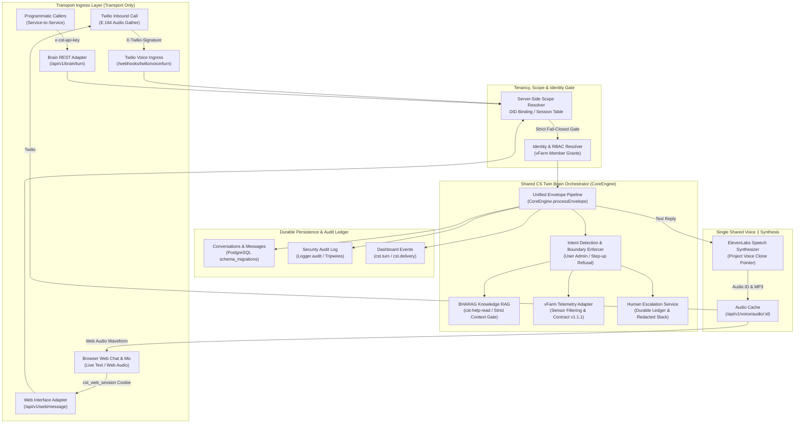

# CS Twin v1 — Locked System Specification

**Specification Version:** 1.0.0 (Locked)  
**Date:** 2026-11-03  
**Status:** IMPLEMENTED_AND_VERIFIED (First Working Slice Shipped)  
**Author:** Senior CST Acceptance & Systems Architecture Engineer (Ahad)  
**Master Trackers:**
- Architecture Loop: [`LOOP-1789824812431-IWKX`](https://dashboard.bhanetwork.org/open-loops/LOOP-1789824812431-IWKX)
- Implementation Decision Watch: `DW-1793621652529-3PQN`
- Upstream Alert & Audit Loop: `LOOP-1788044070645-018M`
- Prior Baseline Spec: [`docs/release/cst-cs-twin-v1-first-working-slice.md`](../release/cst-cs-twin-v1-first-working-slice.md)

---

## 1. Executive Architecture Summary

Customer Service Twin Version 1 (CS Twin v1) provides a unified, fail-closed, multi-tenant conversational intelligence service for vertical farm operations. It serves two distinct external transports—**Inbound Twilio Voice Telephony** and **Browser Web Audio & Chat**—through a **single, shared, tenancy-scoped conversation orchestration brain**.



---

## 2. Voice 1 Architecture & Shared Brain Pipeline

### 2.1 Transport Layer vs. Shared Brain
A critical architectural invariant of CS Twin v1 is that **there is only one customer service brain**:
- **Transport Layer Responsibilities:**
  - Twilio Voice Webhook: Validates cryptographic HMAC signatures (`X-Twilio-Signature`), parses TwiML speech recognition parameters (`SpeechResult`), handles call state machine (`ringing`, `in-progress`, `completed`), and renders TwiML `<Play>` or `<Say>` verbs.
  - Browser Web Audio / Chat: Enforces session cookies (`cst_web_session`), renders accessible DOM landmarks, updates typing indicators (`aria-live="assertive"`), and plays audio via standard Web Audio HTML5 elements.
  - **Neither transport contains business logic, farm knowledge, telemetry parsers, or decision trees.**
- **Shared Brain Responsibilities:**
  - Standardizes all turns into a `MessageEnvelope`.
  - Enforces server-resolved tenancy, system scope, and RBAC permissions.
  - Queries domain knowledge from the BHARAG cluster using isolated read keys.
  - Queries operational telemetry from vFarm while enforcing sensor filtering and Contract v1.1.1 freshness.
  - Persists multi-turn conversations and immutable audit logs.
  - Emits telemetry and dashboard events.

### 2.2 End-to-End Voice 1 Turn Workflow
1. **Audio Ingress & Speech-to-Text:**
   - **Twilio Voice:** Inbound audio stream is captured by Twilio's telephony gather engine. Twilio posts recognized text (`SpeechResult`) to `POST /webhooks/twilio/voice/turn`.
   - **Browser Audio:** The user speaks into the web client microphone; browser native Web Speech API or audio streaming converts speech to text and posts to `POST /api/v1/web/message` with flag `voice: true`.
2. **Turn Deadline & Timeout Guard:**
   - The turn runs under `runVoiceTurnWithDeadline` (default 5,000ms, ceiling 8,000ms).
   - If processing exceeds the deadline, the `AbortSignal` fires, and execution halts before synthesis or transcription persist, returning HTTP 504 `TURN_TIMEOUT` without generating orphan rows.
3. **DID & Tenancy Scope Resolution:**
   - Twilio: Destination number `To` is resolved in `service_number_bindings`. Unbound numbers fail closed with HTTP 404 `SYSTEM_NOT_FOUND`.
   - Web: Session token is resolved in `sessions` store or database. Missing or invalid sessions return HTTP 401 `INVALID_SESSION`.
   - Caller-supplied tenant IDs in the request payload are strictly ignored or checked for mismatch (failing closed on discrepancy).
4. **Speaker Resolution & Farm Authorization:**
   - `CoreRegistry.resolveSpeaker(...)` resolves the caller against the vFarm tenant adapter.
   - Farm boundary access checks verify that the caller is entitled to query the specified farm (`speaker.farm_ids`).
5. **Shared Brain Invocation:**
   - Constructs a canonical `MessageEnvelope` (`channel: 'voice'` or `channel: 'web'`).
   - Executes `CoreEngine.processEnvelope(envelope, speaker)`.
6. **Intent Detection & Knowledge Retrieval:**
   - `IntentRouter` classifies input into `telemetry`, `knowledge`, `status`, `escalation`, or `general_help`.
   - `BharagRagConnector` queries `BHARAG_CLUSTER_URL` using `x-api-key: cst-help-read` sending body `{ query }`. If context is missing, it refuses to guess and fails closed to general help.
   - `VfarmConnector` queries live device metrics filtering strictly by `device_type === 'sensor'`.
7. **Single Voice 1 Speech Synthesis (ElevenLabs):**
   - The resulting text reply is passed to `VoiceInterface.synthesizeSpokenAudio(...)`.
   - The voice ID is resolved strictly from the project's configured voice clone pointer (`project.elevenlabs_voice_id`, e.g. `Hmy9...esiM`).
   - Generic voice fallbacks are strictly prohibited; missing voice pointers drop the audio and return HTTP 422 `NO_VOICE_POINTER`.
   - The synthesized MP3 bytes are cached in memory under a cryptographically random UUID (`audio_id`) with a 5-minute TTL.
8. **Delivery & Audio Playback:**
   - **Twilio Telephony:** Returns TwiML `<Response><Play>https://bha-cst-7u9e.onrender.com/api/v1/voice/audio/:id</Play><Gather .../></Response>`.
   - **Browser Web:** Returns JSON `{ reply_text: "...", audio_url: "/api/v1/voice/audio/:id" }`. The web player renders the audio waveform and initiates playback.
9. **Durable Persistence & Audit Logging:**
   - Persists conversation in `conversations` table.
   - Appends message to `messages_in` and `messages_out` transcripts.
   - Records delivery in `voice_deliveries` table.
   - Emits structured audit row via `Logger.audit` with `entry_point`, `tenant_id`, `actor`, `outcome`, and `correlation_id`.
   - Publishes `cst.turn` event to the central dashboard.

---

## 3. Tenancy-Scoped Brain API Contract

### 3.1 Logical API Definition
The CS Twin Brain API provides a direct, strongly-typed, text-in / text-out programming interface (`POST /api/v1/brain/turn` and `POST /api/v1/brain/chat`).

### 3.2 Authentication & Authorization Rules
1. **Never Anonymous:** Anonymous requests are rejected with HTTP 401 `AUTH_REQUIRED`.
2. **Two Valid Authentication Modes:**
   - **Mode A: Programmatic API Key:** Carried in header `x-cst-api-key: <CST_API_KEY>`. Validated using constant-time string comparison (`secretsMatch`).
   - **Mode B: Verified User Session:** Carried in `Authorization: Bearer <token>`, `x-cst-session: <token>`, or `Cookie: cst_web_session=<token>`.
3. **Server-Side Tenancy Binding:**
   - Callers **cannot** assert arbitrary `tenant_id` or `project_id`.
   - For Mode A, tenancy defaults to the system's bound tenant (`tenant-vfarm-01`) and project (`proj-vfarm-main`). If the caller supplies a `tenant_id` in the body, it **must match** the authorized scope; any mismatch triggers an audit alert and returns HTTP 403 `TENANT_SCOPE_VIOLATION`.
   - For Mode B, tenancy is derived directly from the server-side session.
4. **Speaker Resolution:**
   - Resolved by looking up `phone_e164` or `customer_ref` via `CoreRegistry.resolveSpeaker(...)`.
   - If unresolvable or unknown, the caller is treated as a guest with restricted role `unknown` and empty farm grants (`farm_ids: []`).

### 3.3 Request / Response Schema Contract

#### Request Schema (`POST /api/v1/brain/turn`)
```json
{
  "text": "What is the pH level in Austin HQ rack 1?",
  "channel": "web",
  "project_id": "proj-vfarm-main",
  "speaker_ref": "+9230****3844",
  "correlation_id": "corr_cst_7u9e_1789824812431",
  "conversation_id": "conv_5f9a2b1c-7e3d-4c8a-9b2f-1e4a6d8c0b2e",
  "metadata": {
    "client_version": "v1.0.0"
  }
}
```

#### Response Schema (HTTP 200 OK)
```json
{
  "turn_id": "turn_8a92b3c4-1234-5678-abcd-ef0123456789",
  "conversation_id": "conv_5f9a2b1c-7e3d-4c8a-9b2f-1e4a6d8c0b2e",
  "correlation_id": "corr_cst_7u9e_1789824812431",
  "tenant_id": "tenant-vfarm-01",
  "project_id": "proj-vfarm-main",
  "speaker_ref": "+9230****3844",
  "role": "owner",
  "input_text": "What is the pH level in Austin HQ rack 1?",
  "reply_text": "Austin HQ Rack 1 pH is 6.2 (within optimal range 5.8-6.5).",
  "status": "ok",
  "intent": "telemetry",
  "duration_ms": 342,
  "escalation": {
    "requested": false
  },
  "timestamp": "2026-11-03T21:45:00.000Z"
}
```

#### Error Contract
| HTTP Status | Error Code | Meaning / Cause | Fail-Closed Behavior |
|---|---|---|---|
| `400 Bad Request` | `BAD_REQUEST` | Validation failed (missing text, invalid schema) | Refuses turn, no transcript recorded |
| `401 Unauthorized` | `AUTH_REQUIRED` | Missing API key or invalid session | Refuses turn, audit log tripwire |
| `403 Forbidden` | `TENANT_SCOPE_VIOLATION` | Caller asserted unauthorized tenant_id override | Refuses turn, security audit row written |
| `403 Forbidden` | `AUTHORIZATION_REFUSED` | Caller role lacks access to requested farm/action | Answers with refusal notice, logs audit |
| `404 Not Found` | `RESOURCE_NOT_FOUND` | Unbound DID or missing project | Fails closed |
| `502 Bad Gateway` | `UPSTREAM_UNAVAILABLE` | vFarm or BHARAG network failure | Returns graceful fallback, logs infra warning |
| `504 Gateway Timeout`| `TURN_TIMEOUT` | Processing exceeded 5,000ms deadline | Aborts turn cleanly without orphan DB writes |

---

## 4. CS Twin DID Architecture & Responsibilities

### 4.1 Configured DID Baseline
- **Primary Production Telephony DID:** `+19715885823`
  - Twilio SID: Verified in `bha-cst` Twilio project (`ACd2...0353`).
  - Capabilities: `sms_voice` (Dual Voice & SMS).
  - Binding: Bound to `tenant-vfarm-01`, `proj-vfarm-main` in `service_number_bindings`.
- **Secondary / Dev DID:** `+19715885826` (Voice dedicated).
- **Authorized Acceptance Test Destination:** `+9230****3844` (Project Lead Authorized Handset).
- **Operational Constraint:** No new DID numbers may be purchased or bound without explicit operational approval from Jason.

### 4.2 CS Twin DID Responsibilities
1. **Inbound Routing Authority:**
   - The DID receiving the call (`To`) is the **sole source of truth** for tenant and project resolution.
   - Database table `service_number_bindings` maps `phone_e164 -> (tenant_id, project_id, capability, status)`.
2. **Capability Enforcer:**
   - Verifies `matchesCapability(binding.capability, 'voice')`. If a voice call arrives on an SMS-only number, it rejects the call with HTTP 404 `CAPABILITY_DISABLED`.
3. **Escalation DID Anchor:**
   - When human escalation is triggered, notifications cite the bound service number so responding staff know which farm/tenant project received the request.
4. **Call / Conversation Correlation:**
   - The Twilio `CallSid` is mapped as the root `correlation_id` and tracked through all transcript and audit logs.

---

## 5. Security & Operational Boundaries

1. **Cryptographic Webhook Signatures:**
   All Twilio webhook requests (`/webhooks/twilio/*`) must validate `X-Twilio-Signature` against `TWILIO_AUTH_TOKEN` before database access. Missing or forged signatures return HTTP 403.
2. **Zero Inferred Tenancy:**
   Tenancy is never guessed, inferred from caller phone numbers, or accepted from untrusted body parameters.
3. **Truth & Freshness (Contract v1.1.1):**
   CST never fabricates sensor values or assumes missing health calculation timestamps mean a system is healthy. Missing `calculated_at` timestamps result in `degraded` health status.
4. **Immutability of Audit Ledgers:**
   All security audit events (`Logger.audit`), voice deliveries (`voice_deliveries`), and alert audits (`alert_audit_log`) are append-only.
5. **Component Ownership Model:**
   - **Identity Ownership:** vFarm Tenant Adapter (`VfarmTenantAdapter`) owns user membership, roles, and farm grants.
   - **Operational Truth Ownership:** Physical farm telemetry is owned by vFarm.
   - **Conversation State Ownership:** CST Core Engine owns conversation continuity, message sequencing, and session life cycle.
   - **Knowledge Base Ownership:** Canon knowledge is owned by BHARAG clusters under key `cst-help-read`.

---

## 6. Acceptance & Verification Sign-Off

- **Specification Locked:** Yes
- **Unit & Integration Suite Pass:** 114 test files passed, 1,211 passed, 6 skipped, 0 failed
- **Browser Playwright Pass:** 28 passed across Desktop Chromium and Mobile Chrome (Pixel 5)
- **Reviewer:** Jason / Acceptance Lead
- **Implementation Status:** Shipped in working slice on branch `fix/monitoring-pay-gate-closure`

